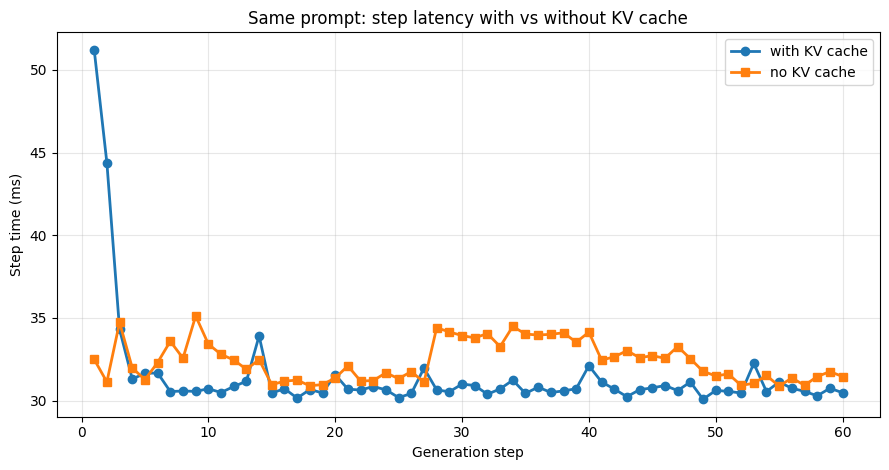
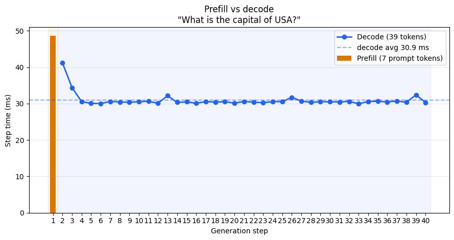

**Difficulty:** Intermediate  
**Big question:** Why does the first output token behave differently from the tokens after it?  
**You will build:** A tiny append-only KV cache, a byte calculator, and a back-of-the-envelope bandwidth bound.

## 1. Two phases of one request

A prompt of 100 tokens and a reply of 3 new tokens is still one request. The work splits into *prefill* and *decode*.

*Prefill* runs the prompt in one forward pass. Attention can use every prompt token together, under the causal mask. The pass writes a key and a value for every prompt position, in every layer. The logits at the last prompt position select the first new token.

*Decode* then runs once per new token. Each step reads the keys and values already stored, appends the key and value of the new token, and samples the next id.

<figure>


<figcaption><span class="figure-label">Figure 1.</span> Prefill handles the prompt in one pass; decode emits one token per step</figcaption>
</figure>

```text
Input prompt: [ P1 P2 P3 ... P100 ]

Prefill:    process P1..P100 together → select G1
            store K and V for every prompt position

Decode 1:   G1 attends to stored K/V → select G2
            append K/V for G1
Decode 2:   G2 attends to the longer cache → select G3
```

In a busy server a scheduler may interleave prefill work and decode work from different requests. That scheduling does not change the split: one phase consumes a known string in parallel, the other extends the string one id at a time.

## 2. What the KV cache stores

Without a cache, step $n$ recomputes keys and values for all $n$ positions, in every layer. The uncached loop in the previous chapter does exactly that. The *KV cache* keeps those keys and values so the next step only projects the new token.

The cache is not the weights. Weights are the learned matrices $W_Q, W_K, W_V$, shared by every request and fixed at inference. The cache is activation state for *this* sequence. Drop the request and you may free the cache. You do not free the model.

For one sequence, one layer, standard attention stores:


$$
\text{bytes} = 2 \times n_{\text{kv}} \times T \times d_h \times \text{bytes per element}
$$


The leading 2 is key and value. $n_{\text{kv}}$ is the number of key/value heads, $T$ is tokens stored so far, and $d_h$ is the head width. Multiply by the layer count $L$ and the batch $B$.

```python
def kv_bytes(layers, kv_heads, head_dim, tokens, bytes_per_elem=2, batch=1):
    """K and V, all layers, one byte count. bytes_per_elem=2 is FP16 or BF16."""
    return 2 * batch * layers * kv_heads * tokens * head_dim * bytes_per_elem

# Llama-2-7B is multi-head: 32 layers, 32 KV heads, head dim 128.
per_token = kv_bytes(layers=32, kv_heads=32, head_dim=128, tokens=1)
print("bytes per token:", per_token)  # 524_288 = 512 KiB

# 512 prompt tokens + 1000 generated tokens.
print("MB at 1512 tokens:", kv_bytes(32, 32, 128, 1512) / 1e6)  # about 793
```

A decode step appends one token's K and V. The read is the whole cache. After a long conversation the cache, not the new token, dominates attention's memory traffic. The projections $W_Q, W_K, W_V, W_O$ and the MLP still have to be loaded too. Those weights do not grow with $T$. The cache does.

This educational step shows the append. `q`, `k`, and `v` would come from linear layers in a real block. Here they are random so you can watch the shapes.

```python
import math
import torch
import torch.nn.functional as F

def attend(q, k, v):
    """q is [B, H, Tq, Dh], k and v are [B, H, Tk, Dh]."""
    scores = q @ k.transpose(-2, -1) / math.sqrt(q.shape[-1])
    if q.shape[-2] == k.shape[-2]:
        t = q.shape[-2]
        mask = torch.triu(torch.ones(t, t, dtype=torch.bool), diagonal=1)
        scores = scores.masked_fill(mask, float("-inf"))
    return F.softmax(scores, dim=-1) @ v

torch.manual_seed(7)
B, T, H, Dh = 1, 4, 2, 4
q, k, v = torch.randn(B, H, T, Dh), torch.randn(B, H, T, Dh), torch.randn(B, H, T, Dh)
prefill = attend(q, k, v)          # [1, 2, 4, 4]
cache_k, cache_v = k, v

q_new = torch.randn(B, H, 1, Dh)
k_new, v_new = torch.randn(B, H, 1, Dh), torch.randn(B, H, 1, Dh)
cache_k = torch.cat([cache_k, k_new], dim=2)
cache_v = torch.cat([cache_v, v_new], dim=2)
decoded = attend(q_new, cache_k, cache_v)   # [1, 2, 1, 4]
print(tuple(prefill.shape), tuple(cache_k.shape), tuple(decoded.shape))
```

On the decode call, `Tq` is 1 and `Tk` is 5. There is no future token to mask: the single query is at the last position, so it may read every cached key. The next chapter's variants change `H` for `k` and `v` only. The append along the sequence axis stays the same.

## 3. A worked memory estimate

Use KV heads, not query heads. Llama-2-70B has 80 layers, 64 query heads, and **8 KV heads**, with $d_h = 128$. At 4096 tokens, FP16, batch 1:

```text
2 × 80 × 8 × 4096 × 128 × 2 bytes ≈ 1.34 GB
```

If you plug in 64 heads by mistake, the same formula prints about 10.7 GB. That number is the multi-head counterfactual, not this checkpoint. The bug is common because model cards list both head counts, and the cache follows the smaller one. [Attention variants](./attention-variants) explains why the smaller count exists.

These are closed-form byte counts under the formula above. They omit allocator padding, paged-cache waste, and the weights. They are not a measured memory profile.

## 4. Why the two phases stress the GPU differently

Prefill multiplies a token matrix by a weight matrix: a GEMM whose token axis is the prompt length. Decode, at batch 1, multiplies a single vector by the same weight matrix: a GEMV.

A useful ratio is *arithmetic intensity*, FLOPs per byte moved. For $y = Wx$ with $W$ shaped `[rows, cols]` in FP16, you do about `2 × rows × cols` FLOPs and you must load the matrix:

```python
def gemv_intensity(rows, cols, bytes_per_elem=2):
    flops = 2 * rows * cols
    moved = (rows * cols + cols + rows) * bytes_per_elem
    return flops / moved

# One square projection at Llama-2-7B width.
print(round(gemv_intensity(4096, 4096), 3))  # about 1.0 FLOP/byte
```

The *ridge* of a chip is peak FLOP/s divided by peak memory bandwidth. An A100 80 GB SXM is about 312 TFLOP/s of FP16 tensor-core math (the dense rate, not the sparse 2×) and about 2.0 TB/s of HBM. The ridge is roughly $312 / 2.0 \approx 156$ FLOP/byte. A GEMV at 1 FLOP/byte sits far below that ridge, so the step is limited by how fast weights move from HBM, not by peak FLOP/s.

A 7-billion-parameter model in 16-bit weights is about $7 \times 10^9 \times 2$ bytes $= 14$ GB. Reading 14 GB at 2 TB/s takes $14 / 2000$ seconds $= 7$ ms. That is a lower bound for one decode step if the device streamed every weight byte once at the brochure bandwidth and did nothing else. Real decode also reads the KV cache, launches many kernels, and does not hold peak bandwidth on each of them. The bound is still the right picture: at batch 1 you pay a weight-load on the order of milliseconds to emit one token.

Raise the batch, or the prompt length, and the same loaded weight is reused across more rows. Intensity scales with that row count. A long prefill can approach the ridge. A single-token decode cannot. Batching many independent decodes amortizes the weight load. It does not shrink the latency of the slowest request for free, which is the tradeoff in the next section.

A useful benchmark measures a specific GPU, a specific kernel, and a specific model. The numbers in this section are arithmetic with stated assumptions, not a benchmark table.

## 5. Latency, throughput, and cost

Three goals pull against each other once this loop is serving real traffic.

| Goal | What you watch | What usually helps | What gives |
|---|---|---|---|
| Latency | Time to first token (TTFT), time per output token (TPOT or inter-token latency) | Shorter prompts, a warm prefix cache, enough bandwidth for the weight load | A GPU that is not packed with other users |
| Throughput | Output tokens per second across concurrent requests | Larger batches, so one weight load serves many decodes | A slower reply for each user |
| Cost | Dollars per million tokens | Higher utilization, fewer bytes per weight (quantization, later) | Latency, or quality, depending on the method |

TTFT includes the prefill of *this* prompt plus queueing. A longer prompt increases TTFT even when you only ask for two output tokens, because prefill work scales with the prompt. A longer answer increases total time mostly through decode steps. It does not redo the prefill.

TPOT is the gap between streamed tokens. If each decode step is near that 7 ms weight-load bound, you are around 140 tokens per second for one stream before overhead. A chat that needs a smooth stream cares about this gap. A batch job cares about throughput. Packing the batch to raise throughput lengthens the step for everyone in it, because the GEMM gets larger and the slowest request waits for the step to finish.

Cost follows from how many tokens you get per second of GPU time you paid for. An idle decode at batch 1 burns the same weight-load as a full one and produces one token. That is the expensive regime.

## 6. Two easy mistakes

Prefill does not write the answer. It writes the prompt's keys and values, and the logits that select the first new token. The rest of the answer is the decode loop.

The KV cache does not remove attention. The new query still scores against every cached key. Caching removes the *recompute* of old keys and values. The stored state grows by one token per step, per layer.


---

**Continue learning:** [← Previous chapter](./autoregressive-generation) · [Next chapter →](./attention-variants)

## 7. Compare cached and uncached generation in the original lab

The [original notebook](https://github.com/rangarajp/rangarajp.github.io/blob/main/notebooks/llm-inference/basic_vLLM_v1.ipynb) used Qwen2.5-0.5B-Instruct with short prompts. Its uncached steps were about 31–35 ms and warmed cached steps about 30–31 ms. Those short traces do not establish a universal speedup or constant decode cost.

<figure>



<figcaption><span class="figure-label">Figure 2.</span> Historical cached and uncached traces from the small-model notebook</figcaption>
</figure>

Without cache reuse, full causal attention recomputation over a prefix has quadratic pairwise work in its length, plus projections and MLP work over all prefix positions. With caching, only the new position is projected, but it still scores against the retained keys. Attention work and cache reads therefore grow with context. Weight streaming and launch overhead can conceal that growth in a short run.

<figure>



<figcaption><span class="figure-label">Figure 3.</span> The original lab separates the one-time prompt pass from later decode steps</figcaption>
</figure>

Use warmup and CUDA synchronization when comparing GPU timings. Hold the input, requested output length, model, and precision fixed, and record each step's prefix length. Report prefill separately from later decode steps; the first output token is selected by prefill.
