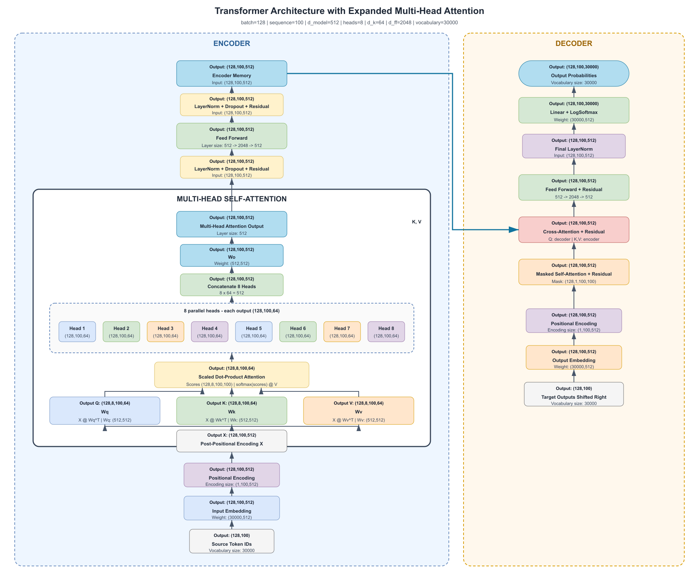
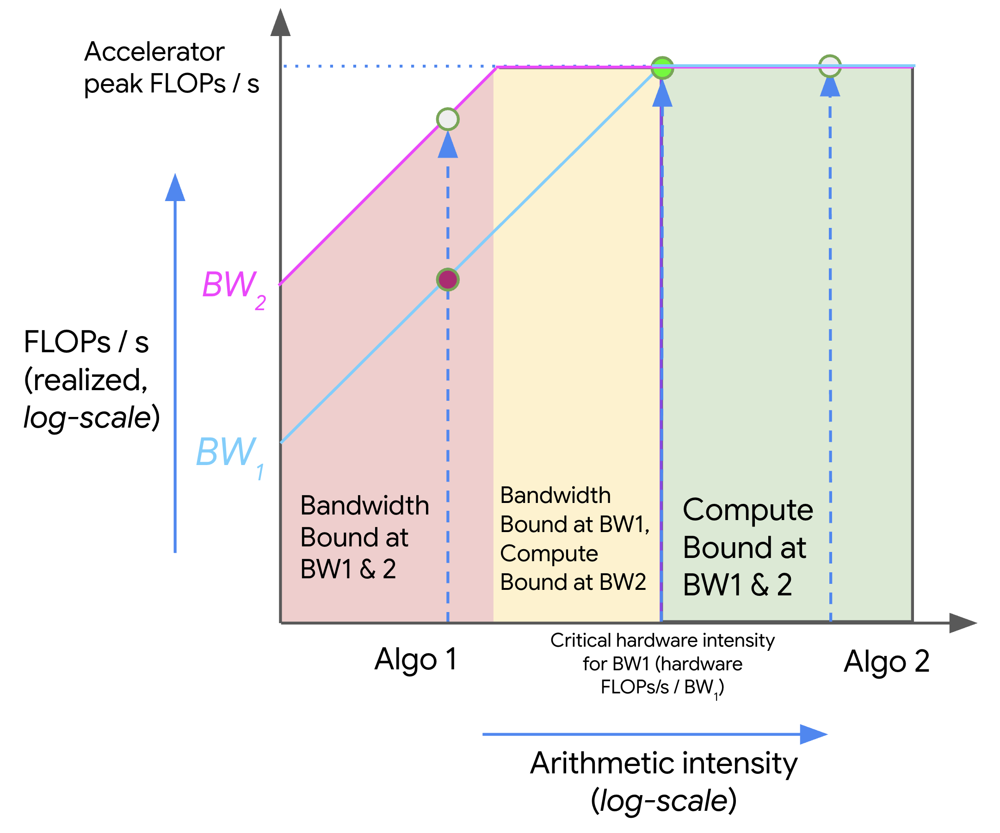

The roofline model tells us which resource can limit a workload. To act on that diagnosis, we need to understand how a GPU executes work and where it stores data. This chapter connects compute units, precision, and memory hierarchy before considering other hardware.

## 2.1 GPU architecture for the inference engineer

Concrete numbers below use the *H100 SXM5* (Hopper) unless noted. Full GH100 silicon has 144 SMs; the shipping SXM5 product exposes 132.

### CPU cores vs streaming multiprocessors

A CPU has a few *cores*, each built for complex, branching, low-latency work. A GPU has many *streaming multiprocessors* (SMs), each running hundreds of lightweight threads in parallel.

| | CPU core | GPU SM (H100) |
|---|----------|----------------|
| Count | Few (8–128) | 132 SMs on H100 SXM |
| Thread model | Few heavy threads, out-of-order, branch prediction | Thousands of tiny threads; in-order issue; hide stalls with more threads |
| Strength | Control flow, latency | Throughput on regular math (matmuls) |
| Local storage | Large private caches, modest register file | Huge *register file* (~256 KB/SM) + L1/shared memory |
| LLM role | Host, I/O, orchestration | Forward pass, Tensor Core matmuls |

Think of an SM as closer to “a mini parallel computer” than to “one CPU core.” A single H100 SM can keep up to *64 warps* resident (up to 2,048 threads) if registers and shared memory allow — that occupancy is how the GPU stays busy while some warps wait on memory.

Transformers are mostly large, regular matrix multiplies — exactly the pattern GPUs were built for.

<figure>


<figcaption><span class="figure-label">Figure 1.</span> Simplified GPU stack — many SMs above shared L2, VRAM at the base</figcaption>
</figure>

Each SM in the diagram is one parallel compute block. Data flows *up* from VRAM through caches into the cores; results flow back down. Inference performance is often about how often you can reuse data before paying the VRAM trip again.

### What runs inside an SM — CUDA cores, Tensor cores, SFU

An SM is not one monolithic processor. It mixes specialized units. On Hopper (H100):

| Unit | Per H100 SM | What it does | LLM inference role |
|------|-------------|--------------|-------------------|
| *CUDA core* (FP32) | 128 | General FP32 / INT32 math | Elementwise ops, softmax pieces, indexing |
| *Tensor core* | 4 (4th gen) | Fused matrix multiply-accumulate (GEMM) | Attention and MLP matmuls — where most FLOPs live |
| *SFU* (special-function unit) | Few per SM | Transcendentals (`exp`, `sin`, `rsqrt`, …) | Activations, parts of softmax and normalization |
| *Load/store* | Dedicated path | Moves data between registers and memory | Feeds every kernel |

Chip-level roll-up for H100 SXM: 132 × 128 = *16,896* FP32 CUDA cores and 132 × 4 = *528* Tensor Cores.

For LLM serving, read specs with this split in mind:

- *Tensor Core TFLOPS* (BF16 / FP16 / FP8) → prefill and large batched matmuls
- *Memory bandwidth* → decode, when weights and KV stream from VRAM every token
- CUDA cores and SFUs matter, but rarely headline the datasheet — they fill gaps around the big GEMMs

Modern kernels (FlashAttention, fused MLPs) are written to keep hot paths on Tensor Cores and minimize round-trips to VRAM.

### Threads, warps, and SIMT — how work actually runs

Software launches *threads*. Hardware does not schedule them one-by-one like a CPU OS. NVIDIA groups them:

| Level | Size | Who schedules it |
|-------|------|------------------|
| *Thread* | 1 | Owns its own registers and program counter |
| *Warp* | 32 threads | Basic execution unit on the SM |
| *Thread block* | Many warps | Assigned to one SM; can share L1 / shared memory |
| *Grid* | Many blocks | Whole kernel launch across the GPU |

A *warp* is the unit the SM’s *warp scheduler* picks each cycle. All 32 threads in a warp issue the *same instruction* on that cycle — this is *SIMT* (single instruction, multiple threads).

How that relates to *SIMD*:

- *SIMD* (single instruction, multiple data) — classic vector hardware: one instruction operates on a wide vector register
- *SIMT* — same idea at the programming model: you write scalar per-thread code; the hardware packs 32 threads into a warp and runs them lockstep when paths agree

So: SIMD is the vector *hardware* intuition; SIMT is NVIDIA’s *thread* abstraction on top. Both buy throughput by doing one instruction across many data lanes. GPUs add the twist that each thread has its own registers and can *diverge* (as described under warp divergence below).

*Parallelism* on a GPU is therefore hierarchical:

1. *Thread-level* — each thread processes its own element / tile
2. *Warp-level* — 32 threads share an instruction stream
3. *SM-level* — many warps resident; schedulers pick ready warps
4. *GPU-level* — 132 SMs on H100 SXM run different blocks at once

That stack is why “more concurrent tokens / larger tiles” often raises utilization: you give the schedulers more independent warps to choose from while others wait on HBM.

### Registers and latency hiding

The fastest storage on the chip is not L1 — it is the *register file*.

| Resource (H100 SM) | Size / limit | Role |
|--------------------|--------------|------|
| Register file | 256 KB (~64K 32-bit registers) | Per-thread live values; compiler allocates |
| Max registers / thread | 255 | More registers per thread → fewer resident warps |
| Max warps / SM | 64 | Upper bound on occupancy |
| Shared memory / L1 carveout | Up to ~228 KB shared | Programmer-managed scratchpad + L1 |

*Latency* here means “how many cycles until a result or a memory load is ready.” Math ops are short; a trip to HBM is long (hundreds of cycles). CPUs fight that with caches, speculation, and out-of-order execution. GPUs fight it mainly by *latency hiding*:

1. Warp A issues a load from VRAM and stalls
2. Scheduler switches to warp B (or C, D, …) that already has data in registers
3. When A’s data arrives, A becomes eligible again

So a “slow” memory system can still deliver high throughput if enough warps are *resident*. That is why occupancy, register pressure, and shared-memory use show up in CUDA/Triton tuning — they control how many warps fit on the SM.

Registers are private per thread (within the SM’s shared register file). Spilling registers to local memory (backed by VRAM) is a common performance cliff: you traded occupancy or spilled, and suddenly every “register” access pays HBM latency.

### Warp divergence — when threads in a warp disagree

Because a warp issues one instruction at a time, *branch divergence* is expensive.

If 32 threads hit `if (cond) { A } else { B }`:

1. Threads that take `A` run while the others are masked off (idle)
2. Then threads that take `B` run while the first group is masked off
3. Wall time is roughly *time(A) + time(B)*, not `max(A, B)`

That is *warp divergence*: lockstep SIMT becomes serialized paths inside the warp. Uniform control flow (all 32 threads take the same branch) stays efficient.

Why this matters for LLM kernels:

- Softmax, masking, and variable-length sequences can introduce divergent paths if written naively
- Well-structured kernels keep warps coherent — same sequence lengths padded in a tile, mask handled so lanes stay aligned, or special cases peeled into separate launches
- Divergence wastes *ALU / Tensor Core* cycles the same way poor occupancy wastes *memory* latency hiding — different failure modes, same symptom: low achieved TFLOPS

Rule of thumb: threads are free to branch; *warps* pay for disagreement.

## 2.2 Tensor cores and mixed precision

Tensor cores accelerate supported matrix operations. They require compatible formats, shapes, and kernels. FP16 and BF16 both use two bytes, but BF16 has a wider exponent range and fewer fraction bits. Accumulation may use a higher precision than multiplication. FP8 and integer formats require explicit scaling and supported kernels; changing a tensor dtype alone does not establish an efficient quantized execution path.

## 2.3 Memory hierarchy and bandwidth

### Two memory worlds — DRAM capacity vs SRAM speed

GPUs sit at two very different memory scales:

| Memory | Typical size | Technology | Role |
|--------|-------------|------------|------|
| *VRAM* (device memory) | GB (80 GB HBM3 on H100 SXM) | HBM or GDDR — off-chip DRAM | Weights, KV cache, activations |
| *On-chip SRAM* | MB per chip (L1 + shared L2) | Static RAM on die | Hot tiles of weights and activations during a kernel |

The pattern is always the same: *large and slow at the bottom, small and fast at the top.*

- *DRAM (GB)* — cheap per bit, high capacity. This is where the 70B model and every concurrent KV cache must live.
- *SRAM (MB)* — expensive per bit, low latency. Kernels win when they reuse the same bytes many times while data still sits in L1/L2.

That is why a fat matmul (prefill) can be *compute-bound* — each weight byte gets reused across many tokens — while skinny decode (one token) is often *memory-bound* — little reuse before the next VRAM read.

CPU system memory is a third tier. Its local DDR bandwidth and the PCIe bandwidth used to reach the GPU are separate limits. Treat it as staging, not the hot store for serving. See [GPU Architecture](./gpu-fundamentals) for sizing weights and KV in HBM.

### Cache hierarchy — L0, L1, L2

Between VRAM and the cores, modern GPUs use a ladder of progressively larger, slower stores. Exact sizes vary by architecture; H100 SXM has about *50 MB* of L2 shared across the chip.

| Level | Scope | Typical role |
|-------|-------|--------------|
| *Registers* | Per thread | Hottest values; not a cache, but the top of the latency stack |
| Operand reuse mechanisms | Architecture-specific | Reuse operands close to execution; not a portable programmer-visible cache level |
| *L1* + *shared memory* | Per SM | Tile of a matmul, a slice of activations; shared memory is software-managed |
| *L2* | Whole GPU (shared) | Last stop before VRAM; all SMs compete for it |
| *VRAM / HBM* | Whole GPU | Model weights, KV, large activations |

Data path for one kernel launch:

1. Load from *VRAM* into *L2* (if not already resident)
2. SM pulls tiles into *L1* / shared memory
3. Values land in *registers*; *Tensor Cores* / CUDA cores consume them

When a kernel says it is “memory-bound,” it usually means the SM is waiting on L2 or VRAM, not that Tensor Cores are idle by choice. Optimizations (fusion, tiling, quantization) shrink bytes moved across that path — and more resident warps hide the remaining latency.

Figure 1 shows the two levels that matter most at a glance: *L1 per SM* and *L2 shared* above *VRAM*.

### Memory hierarchy and bandwidth

Tiling loads a piece of each matrix once and reuses it across many products. Fusion keeps intermediate values close to execution rather than writing them to HBM. Neither creates more HBM capacity. A small-batch decode can remain bandwidth limited even while most tensor-core capacity is idle.

```python
# CPU-only arithmetic: reuse of one matrix over independent token rows.
rows, cols, element_bytes = 4096, 4096, 2
for tokens in (1, 8, 64, 512):
    flops = 2 * tokens * rows * cols
    moved = (rows * cols + tokens * (rows + cols)) * element_bytes
    print(tokens, round(flops / moved, 2), 'FLOP/byte')
```

The ratio rises with token rows because weights are amortized. This model ignores caches, launch overhead, and kernel efficiency. It explains a trend; it cannot replace a profile.

### Sizing the pantry — weights, KV cache, misc

GPU HBM capacity (24 GB, 48 GB, 80 GB, …) is the first hard wall. Budget it as:

$$
\text{GPU memory} \approx \text{model weights} + \text{KV cache} + \text{misc}
$$

A model that “fits” at idle can still OOM under load. Memory decides *whether* you can serve; bandwidth and FLOPS decide *how fast*.

#### Weights

$$
\text{Weight memory (bytes)} \approx \text{parameters} \times \text{bytes per parameter}
$$

| Format | Bits | Bytes |
|--------|------|-------|
| FP32 | 32 | 4 |
| FP16 / BF16 | 16 | 2 |
| INT8 / FP8 | 8 | 1 |
| INT4 | 4 | 0.5 |

| Parameters | FP16 / BF16 | FP8 / INT8 | INT4 |
|------------|-------------|------------|------|
| 7B–8B | ~14–16 GB | ~7–8 GB | ~3.5–4 GB |
| 70B | ~140 GB | ~70 GB | ~35 GB |

#### KV cache — from transformer shapes

Keys and values are what get cached. Use a consistent shape from the dimension diagram:

<figure>



<figcaption><span class="figure-label">Figure 2.</span> Transformer dimensions used for KV sizing (batch 128, sequence 100, d_model 512, heads 8, d_k 64)</figcaption>
</figure>

| Symbol | Value in the figure | Meaning |
|--------|---------------------|---------|
| batch $B$ | 128 | parallel sequences |
| sequence $S$ | 100 | tokens in context |
| $d_{\text{model}}$ | 512 | model width |
| heads $H$ | 8 | attention heads |
| $d_k$ | 64 | per-head size ($d_{\text{model}} / H$) |

Projected K and V each have shape $(B,\ H,\ S,\ d_k) = (128,\ 8,\ 100,\ 64)$.

For one attention layer, store K and V:

$$
\text{KV elements per layer} = 2 \times B \times H \times S \times d_k
$$

$$
\begin{align*}
&= 2 \times 128 \times 8 \times 100 \times 64 \\
&= 13{,}107{,}200 \text{ elements}
\end{align*}
$$

At FP16 (2 bytes):

$$
13{,}107{,}200 \times 2 \approx 26.2\ \text{MB per layer}
$$

Check: $H \times d_k = d_{\text{model}}$, so the same number is $2 \times B \times S \times d_{\text{model}} \times \text{bytes}$.

For a stack of $L$ layers (decoder self-attention — the usual LLM case):

$$
\text{KV cache} = 2 \times L \times B \times H \times S \times d_k \times \text{bytes}
$$

Classic small transformer with $L = 6$, FP16, same $B,S$:

$$
6 \times 26.2\ \text{MB} \approx 157\ \text{MB}
$$

Tiny versus the weights — because $d_{\text{model}}=512$ and $S=100$. Real models are wider, deeper, and use much longer contexts.

Per-token form (handy for serving math):

$$
\text{bytes per token (all layers)} = 2 \times L \times H \times d_k \times \text{bytes}
$$

Diagram model, $L=6$, FP16: $2 \times 6 \times 8 \times 64 \times 2 = 12{,}288$ bytes ≈ 12 KB per token.  
At $S=100$: $12\ \text{KB} \times 100 = 1.2\ \text{MB per sequence}$; $\times B=128$ ≈ 157 MB — same as above.

#### Rough estimate for a modern Llama-class 8B

Take a Llama-3-class 8B decoder-only model (GQA):

| Spec | Typical value |
|------|----------------|
| Parameters | ~8B |
| Layers $L$ | 32 |
| KV heads $H_{\text{kv}}$ | 8 (not 32 — grouped-query attention) |
| Head dim $d_k$ | 128 |
| Weight dtype | BF16 / FP16 → ~16 GB weights |

Per token (K+V, all layers, FP16):

$$
2 \times 32 \times 8 \times 128 \times 2 = 131{,}072\ \text{bytes} \approx 128\ \text{KB/token}
$$

| Context length $S$ | KV for 1 request | KV for batch $B$ |
|--------------------|------------------|------------------|
| 1k | ~128 MB | $B \times 128$ MB |
| 2k | ~256 MB | $B \times 256$ MB |
| 4k | ~512 MB | $B \times 512$ MB |
| 8k | ~1 GB | $B \times 1$ GB |

GQA (8 KV heads) already cuts KV versus full MHA (32 heads) by about 4×. Multi-query or more aggressive GQA shrinks it further.

#### Misc

Reserve headroom beyond weights + KV:

| Item | Typical ballpark |
|------|------------------|
| CUDA context + cuBLAS / engine | ~0.5–2 GB |
| Activations / workspace (prefill) | grows with $B$ and $S$; often 1–4+ GB |
| Fragmentation / allocator slack | ~10% of free memory is a safe cushion |
| Torch / vLLM overhead | depends on engine; keep a fixed reserve |

Rule of thumb for planning:

$$
\text{Usable for KV} \approx \text{GPU GB} - \text{weights} - \text{misc reserve}
$$

Use about 2–4 GB misc on a 24 GB card and 3–5 GB on a 48 GB card unless you have measured otherwise.

#### How many concurrent requests? — 24 GB vs 48 GB

Example: Llama-class 8B BF16 (~16 GB weights), FP16 KV (~128 KB/token), misc reserved as below.

*24 GB GPU* (for example A10-class / consumer 24 GB):

| | Estimate |
|---|----------|
| Weights | 16 GB |
| Misc reserve | 3 GB |
| Left for KV | ~5 GB |

$$
\text{Max total cached tokens} \approx \frac{5\ \text{GB}}{128\ \text{KB/token}} \approx 40{,}000\ \text{tokens}
$$

| Avg context per request | Max concurrent batch $B$ (approx.) |
|-------------------------|-------------------------------------|
| 1k tokens | ~40 |
| 2k | ~20 |
| 4k | ~10 |
| 8k | ~5 |

*48 GB GPU* (for example L40S):

| | Estimate |
|---|----------|
| Weights | 16 GB |
| Misc reserve | 4 GB |
| Left for KV | ~28 GB |

$$
\text{Max total cached tokens} \approx \frac{28\ \text{GB}}{128\ \text{KB/token}} \approx 224{,}000\ \text{tokens}
$$

| Avg context per request | Max concurrent batch $B$ (approx.) |
|-------------------------|-------------------------------------|
| 1k tokens | ~220 |
| 2k | ~110 |
| 4k | ~55 |
| 8k | ~28 |

Same model, same dtype: roughly 5–6× more concurrent sequences on 48 GB than on 24 GB, because almost all of the extra 24 GB becomes KV headroom.

What changes the batch you can actually run:

- Longer context → fewer parallel requests (linear in $S$)
- FP8/INT8 weights → more room for KV (for example ~8 GB weights → much higher $B$ on 24 GB)
- Larger model (70B) → may not fit in 24/48 GB without quantisation and multi-GPU
- Prefill activations → peak memory can exceed the steady decode KV budget; engines often limit max batch/context for that reason

So the 24 vs 48 GB question is rarely “does 8B fit?” (both can). It is *how much concurrent context* you can keep warm — and that is almost entirely a KV-cache sizing problem once weights are loaded.

### Choose hardware by the scarce resource

Capacity determines whether weights, growing caches, and workspace fit. Bandwidth sets an ideal weight-streaming bound. Compute throughput matters when the matrix shapes expose enough reuse. Interconnect matters when work is sharded; topology, transfer direction, and synchronization matter as much as a link's headline rate.

For a concrete historical comparison, H100 SXM provides 80 GB and 3.35 TB/s; H100 NVL provides 94 GB per GPU and 3.9 TB/s. The NVIDIA BF16 figures of 1,979 and 1,671 TFLOP/s include structured sparsity. For dense roofline arithmetic use approximately half those rates. Do not mix sparse and dense figures in one comparison. These are specifications, not observed application throughput.

See [NVIDIA H100 specifications](https://www.nvidia.com/en-in/data-center/h100/), [GPU fundamentals](./gpu-fundamentals), and [inference mathematics](./gpu-fundamentals).

### Recalculate a capacity budget without rounding units

```python
# Decimal GB capacity and actual bytes per cached token.
weights, bytes_per_token = 8e9 * 2, 2 * 32 * 8 * 128 * 2
for capacity, reserve in ((24e9, 3e9), (48e9, 4e9)):
    tokens = int((capacity - weights - reserve) // bytes_per_token)
    print(int(capacity / 1e9), 'GB:', tokens, 'cached tokens;', tokens // 4096, 'full 4096-token requests')
```

The earlier tables use rounded k-token and KB estimates. This calculation yields about 38,146 and 213,623 cached tokens, or 9 and 52 complete 4096-token requests. It still omits block padding and worst-case prefill workspace; reserve output growth before admitting those requests.

### Notation

| Symbol | Meaning |
|--------|---------|
| $B$ | Batch size (rows of activations; concurrent tokens or sequences in a step) |
| $D$, $F$ | Inner / output feature dimensions of a linear layer ($Z = X Y$ with $X\!:\![B,D]$, $Y\!:\![D,F]$) |
| $L$ | Number of transformer layers |
| $n$ / $s$ / $T$ | Sequence length (prompt + generated so far; $T$ in attention FLOP counts) |
| $d$ / $d_{\text{model}}$ | Hidden size |
| $n_q$, $n_{kv}$ | Query heads / KV heads |
| $d_h$ | Head dimension ($d_{\text{model}} / n_q$ for MHA) |
| $p$, $c$ | Prompt tokens / completion tokens |
| $I$ | Arithmetic intensity (FLOPs per byte moved) |
| $T_{\text{math}}$, $T_{\text{mem}}$ | Pure compute time / pure memory time |

### Two clocks — math and memory

Two ideal resource times provide a lower bound. Real kernels also pay launch, synchronization, and efficiency costs:

$$
T_{\text{math}} = \frac{\text{FLOPs}}{\text{peak FLOPs/s}}, \qquad
T_{\text{mem}} = \frac{\text{bytes moved}}{\text{peak bandwidth (bytes/s)}}
$$

$$
T_{\text{wall}} \;\ge\; \max\!\big(T_{\text{math}},\, T_{\text{mem}}\big)
\quad\text{(ideal resource lower bound)}
$$

- If $T_{\text{math}} > T_{\text{mem}}$ the kernel is *compute-bound* — Tensor Cores are busy; more bandwidth barely helps.
- If $T_{\text{mem}} > T_{\text{math}}$ the kernel is *memory-bound* (bandwidth-bound) — cores sit idle waiting on HBM.

H100 SXM numbers used throughout this chapter (dense BF16 Tensor peak, not the sparse datasheet figure):

| Resource | Value |
|----------|------:|
| Peak BF16 | $989 \times 10^{12}$ FLOPs/s |
| HBM bandwidth | $3.35$ TB/s $= 3.35 \times 10^{12}$ B/s |
| Ridge intensity | $989 / 3.35 \approx 295$ FLOPs/byte |

#### Dot product — the smallest example

For two length-$N$ vectors the exact op count is $N$ multiplies + $(N-1)$ adds $= 2N - 1$ FLOPs. With BF16 (2 bytes/elem), you read both vectors and write one scalar:

$$
I_{\text{dot}} = \frac{2N - 1}{4N + 2} \;\xrightarrow{N \to \infty}\; \tfrac{1}{2}\ \text{FLOP/byte}
$$

At $N = 1000$ that is $\approx 1999$ FLOPs and $\approx 4002$ bytes. On an H100:

$$
T_{\text{math}} = \frac{1999}{9.89 \times 10^{14}} \approx 2.0 \times 10^{-12}\ \text{s}
$$

$$
T_{\text{mem}} = \frac{4002}{3.35 \times 10^{12}} \approx 1.2 \times 10^{-9}\ \text{s}
$$

The ideal memory term is much larger than the ideal math term. A single tiny dot product can instead be dominated by launch latency; these peak-rate divisions are not a prediction of its measured duration. Real kernels only escape this fate when they *reuse* bytes many times (large matmuls, fat batches).

### Matmul FLOPs, bytes, and intensity

The companion spreadsheet [Inference_Math_Basics.xlsx](https://github.com/rangarajp/rangarajp.github.io/blob/main/src/content/concepts/llm-inference/Inference_Math_Basics.xlsx) lets you vary batch size and matrix dimensions alongside these calculations.

A BF16 GEMM $Z = X Y$ with shapes $X\!:\![B,D]$, $Y\!:\![D,F]$, $Z\!:\![B,F]$ is the workhorse of transformers (every linear / projection / MLP block).

#### Why $2BDF$ — count from one output cell

Take a tiny matmul so the counting is obvious:

$$
X\!:\![3,2]\ \times\ Y\!:\![2,3]\ \rightarrow\ Z\!:\![3,3]
$$

Here $B=3$, $D=2$, $F=3$. One entry of $Z$ is a length-$D$ dot product:

$$
z_{ij} = \sum_{k=1}^{D} x_{ik}\, y_{kj}
$$

- *Multiplies* — $D$ (here $2$)
- *Additions* — $D-1$ (here $1$), to fold those products into one scalar

Exact FLOPs for one output cell: $D + (D-1) = 2D - 1$. The output has $B \times F$ cells, so

$$
\text{FLOPs}_{\text{exact}} = BF\,(2D - 1)
$$

For this toy shape: $3 \times 3 \times (2\cdot 2 - 1) = 27$. For large $D$ the $-1$ is noise, so we drop it:

$$
\text{FLOPs} \approx BF \cdot 2D = 2BDF
$$

Same story in words: fill $BF$ outputs; each costs about $2D$ FLOPs (one mul and one add per inner index). That is where the factor of two comes from — not “two matmuls,” but *mul + add* along the shared dimension $D$.

#### Same count for attention scores

Score matmul $S = Q K^{\mathsf{T}}$ for one head (batch omitted, or fold it into $T$):

| Matrix | Shape |
|--------|-------|
| $Q$ | $[T,\, d_h]$ |
| $K^{\mathsf{T}}$ | $[d_h,\, T]$ |
| $S$ | $[T,\, T]$ |

Map to the GEMM labels: $B \to T$, $D \to d_h$, $F \to T$. Then

$$
\text{FLOPs}(QK^{\mathsf{T}}) \approx 2\, T \cdot d_h \cdot T = 2\, d_h\, T^{2}
$$

Or from the cell-counting view again: $S$ has $T^{2}$ entries to fill; each is a length-$d_h$ dot product $\approx 2 d_h$ FLOPs → $2 d_h T^{2}$.

(The later $SV$ multiply with $V\!:\![T, d_h]$ is another $2\, T \cdot T \cdot d_h = 2 d_h T^{2}$. Softmax itself is lower order in the usual FLOP accounting.)

| Quantity | Formula (BF16 = 2 bytes/elem) |
|----------|-------------------------------|
| FLOPs | $2 B D F$ (approx.; exact is $BF(2D-1)$) |
| Bytes read | $2BD + 2DF$ |
| Bytes written | $2BF$ |
| Bytes total | $2BD + 2DF + 2BF$ |
| Intensity | $I = 2BDF / (2BD + 2DF + 2BF)$ |

When $B \ll D,F$ the weight term $2DF$ dominates the traffic and

$$
I \approx \frac{BDF}{DF} = B
$$

Raising batch size is the main way to climb the roofline for a fixed layer shape. Prefill (many tokens at once) sits higher on that curve than single-token decode.

If you count *reads only* (as in the companion spreadsheet), drop the $2BF$ write:

$$
I_{\text{reads}} = \frac{2BDF}{2BD + 2DF} = \frac{BDF}{BD + DF}
$$

For square hidden size $D = F = d$, that simplifies to

$$
I_{\text{reads}} = \frac{d\, B}{B + d}
$$

### The roofline

Plot arithmetic intensity on the $x$-axis and attainable FLOPs/s on the $y$-axis. Hardware draws a *roof*: a diagonal set by bandwidth, then a flat ceiling set by peak FLOPs. The elbow is the *ridge point*:

$$
I_{\text{ridge}} = \frac{\text{peak FLOPs/s}}{\text{peak bandwidth}}
$$

<figure>



<figcaption><span class="figure-label">Figure 3.</span> Roofline: low-intensity kernels ride the bandwidth slope; high-intensity kernels hit the compute ceiling</figcaption>
</figure>

- *Algo 1* (left) — low $I$: raising bandwidth moves you up the slope; extra TFLOPS do nothing.
- *Algo 2* (right) — high $I$: you are already on the ceiling; more HBM bandwidth does not help.

LLM serving maps onto this picture almost for free: *prefill* tends toward Algo 2; *decode* tends toward Algo 1. See also [production metrics](./observability-slos) and the roofline derivation above.

### Worked matmuls — H100 linear layers

The spreadsheet walks three BF16 cases of $X\!:\![B, 4096] \times Y\!:\![4096, 4096]$. Intensity below uses the *reads-only* form that matches the sheet ($I = 4096 B / (B + 4096)$). H100 ridge $\approx 295$ FLOPs/byte.

#### Case A — $B = 32$ (decode-ish)

| Quantity | Value |
|----------|------:|
| FLOPs ($2BDF$) | $1.074 \times 10^{9}$ ($\approx 1.07$ GFLOP) |
| $X$ bytes ($2BD$) | $0.26$ MB |
| $Y$ bytes ($2DF$) | $33.55$ MB |
| Total traffic | $33.82$ MB |
| Intensity | $\approx 31.8$ FLOPs/byte |
| vs H100 ridge | $31.8 \ll 295$ → *memory-bound* |

#### Case B — $B = 256$

| Quantity | Value |
|----------|------:|
| FLOPs | $8.59 \times 10^{9}$ ($\approx 8.59$ GFLOP) |
| $X$ bytes | $2.10$ MB |
| $Y$ bytes | $33.55$ MB |
| Total traffic | $35.65$ MB |
| Intensity | $\approx 241$ FLOPs/byte |
| vs H100 ridge | $241 < 295$ → still *memory-bound*, but close |

#### Case C — find the critical batch

Set intensity equal to the ridge and solve for $B$:

$$
\frac{4096\, B}{B + 4096} = \frac{989}{3.35} \approx 295
\quad\Rightarrow\quad
B \gtrsim 318
$$

| $B$ | $I$ (FLOPs/byte) | Regime on H100 |
|----:|-----------------:|----------------|
| 1 | $\approx 1$ | Deeply memory-bound (token decode) |
| 32 | $\approx 32$ | Memory-bound |
| 256 | $\approx 241$ | Memory-bound, near ridge |
| $\ge 318$ | $\ge 295$ | Compute-bound |

Same story for a fatter projection $x\!:\![B, 4096]$, $W\!:\![4096, 16384]$ (including the $Z$ write). With the fuller traffic $2BD + 2DF + 2BF$:

$$
T_{\text{math}} = \frac{2 B \cdot 4096 \cdot 16384}{9.89 \times 10^{14}}, \qquad
T_{\text{mem}} = \frac{2BD + 2DF + 2BF}{3.35 \times 10^{12}}
$$

$T_{\text{math}} > T_{\text{mem}}$ once $B \gtrsim 325$ under these assumptions. Below that batch you are leaving Tensor Cores underfed — the usual decode pathology.

### Precision changes the ridge

Cut element size and you move two things at once: fewer bytes on the wire, and (often) a higher peak op rate.

#### INT8 matmul with illustrative hardware rates

With 1 byte/elem, $X\!:\![B,D]$, $Y\!:\![D,F]$, $Z\!:\![B,F]$:

| Quantity | Formula |
|----------|---------|
| FLOPs | $\approx 2 B D F$ |
| Bytes | $BD + DF + BF$ |
| Intensity | $I = 2BDF / (BD + DF + BF) \approx 2B$ when $B \ll D,F$ |

On a machine with int8 peak $3.94 \times 10^{14}$ ops/s and HBM $8.2 \times 10^{11}$ B/s, the ridge is

$$
I_{\text{ridge}} = \frac{3.94 \times 10^{14}}{8.2 \times 10^{11}} \approx 481\ \text{ops/byte}
$$

Requiring $2B \gtrsim 481$ gives $B \gtrsim 240$. Smaller batches stay memory-bound even in int8; the win is that *the same* $B$ now moves half the bytes of BF16, so $T_{\text{mem}}$ drops.

The rates in this INT8 example are illustrative and are not the H100 rates used above. A serialized resource sum ignores overlap and overhead; it is not an upper bound on actual runtime.

Runtime estimates:

$$
T_{\text{math}} = \frac{2BDF}{3.94 \times 10^{14}}, \qquad
T_{\text{mem}} = \frac{BD + DF + BF}{8.2 \times 10^{11}}
$$

$$
T_{\text{lower}} = \max(T_{\text{math}}, T_{\text{mem}}), \qquad
T_{\text{serial model}} = T_{\text{math}} + T_{\text{mem}}
$$

Weight-only quantization for serving is the same idea applied to the $DF$ term: shrink the dominant traffic when $B$ is small. See [Quantization](./quantization).

### Memory and KV cache

Weights and KV compete for the same HBM:

$$
\text{Weight bytes} \approx N_{\text{params}} \cdot \frac{\text{bits}}{8}
$$

$$
\text{KV bytes} \approx 2 \cdot L \cdot n_{kv} \cdot d_h \cdot n \cdot B \cdot \text{bytes/elem}
$$

(The leading $2$ is keys + values. GQA/MQA shrink $n_{kv}$ relative to $n_q$.)

#### Worked example — 7B MHA on H100 80 GB

| Input | Value |
|-------|------:|
| Parameters | 7B |
| Layers $L$ | 32 |
| Hidden $d_{\text{model}}$ | 4096 |
| Attention heads | 32 (MHA) |
| Weight / KV precision | BF16 |
| Prompt / generate | 4096 / 1024 tokens |
| Concurrency $B$ | 1 |
| GPU | H100 SXM 80 GB |

| # | Output | Answer |
|--:|--------|-------:|
| 1 | Head dimension $d_h$ | $4096 / 32 = 128$ |
| 2 | Weight memory (BF16) | $7\times 10^9 \times 2 \approx 14$ GB |
| 3–5 | Q / K / V per token, 1 layer | $[32, 128] = 4096$ values each |
| 6–7 | K or V cache / token / layer | $4096 \times 2 = 8192$ B $= 8$ KiB |
| 8 | KV / token / layer | $16$ KiB |
| 9 | KV / token / 32 layers | $512$ KiB $= 524{,}288$ B |
| 10 | KV for 4096-token prompt | $4096 \times 512$ KiB $= 2$ GiB |
| 11 | KV after +1024 generated ($n=5120$) | $2.5$ GiB |
| 12 | Weights + final KV | $\approx 16.7$ GB |
| 13 | H100 memory remaining | $\approx 63.3$ GB |

Remaining capacity is what you spend on *concurrency*: each extra in-flight sequence needs its own KV footprint at the current context length. Paging reduces allocation waste. Identical prefixes can also share physical cache blocks, reducing duplicated storage across requests; ordinary unshared per-sequence KV still grows linearly with retained tokens.

### Quick reference

| Question | Formula / rule |
|----------|----------------|
| Wall-time lower bound | $\max(T_{\text{math}}, T_{\text{mem}})$ |
| Intensity | FLOPs / bytes moved |
| H100 BF16 ridge | $\approx 295$ FLOPs/byte |
| Matmul FLOPs | $\approx 2BDF$; exact $BF(2D-1)$ (mul + add per inner index) |
| Attention $QK^{\mathsf{T}}$ (one head) | $\approx 2\, d_h\, T^{2}$ |
| Square $d{\times}d$ layer, reads-only | $I = d B / (B + d)$; compute-bound when $B \gtrsim I_{\text{ridge}}$ |
| E2E latency | TTFT + $(c-1)\cdot\overline{\text{ITL}}$, with queueing already inside TTFT |
| KV bytes | $2\, L\, n_{kv}\, d_h\, n\, B\, \times$ bytes/elem |
| Decode HBM floor | weight_bytes_per_GPU / HBM_bandwidth |

Keep [`Inference_Math_Basics.xlsx`](https://github.com/rangarajp/rangarajp.github.io/blob/main/src/content/concepts/llm-inference/Inference_Math_Basics.xlsx) open while you change shapes — the ridge does not move, but your kernel's $I$ does.

### Reproduce the matrix estimates

```python
def projection_budget(batch, inner=4096, output=4096, element_bytes=2):
    flops = 2 * batch * inner * output
    moved = (batch * inner + inner * output + batch * output) * element_bytes
    compute_s = flops / 989e12
    memory_s = moved / 3.35e12
    return flops, moved, flops / moved, max(compute_s, memory_s)

for batch in (1, 32, 256, 512):
    flops, moved, intensity, lower = projection_budget(batch)
    print(batch, round(flops / 1e9, 3), 'GFLOP', round(moved / 1e6, 3),
          'MB', round(intensity, 2), 'FLOP/byte', round(lower * 1e6, 3), 'microseconds lower bound')
```

This counts output writes, unlike the reads-only spreadsheet column. Do not compare those intensities without reconciling the denominator. The tiny ideal times exclude kernel overhead and do not represent a measured benchmark.

## 2.4 CPU and edge hardware

CPUs offer large system memory and flexible control flow, but their effective matrix throughput and memory bandwidth differ from a GPU's. Unified-memory devices share a memory pool with the operating system. A nominal capacity is not the amount an application can safely consume. Measure sustained performance, power, and thermal behavior for on-device use.

## 2.5 Emerging hardware trends

More HBM capacity, faster interconnects, and new low-precision instructions help different bottlenecks. An interconnect upgrade helps sharded execution only when communication matters. More tensor throughput helps compute-heavy prefill only when the kernels can use it. Start with a trace and a memory budget before choosing hardware.

Dedicated accelerators pursue different balances of arithmetic, storage, and interconnect. Large matrix arrays favor regular dense operations; SRAM-centric designs keep a smaller working set close to execution; larger integrated fabrics reduce some communication distances. Each choice moves a constraint rather than eliminating it: a model that exceeds the local working set still needs partitioning or another storage tier.

For a new device, first establish model/operator support, accessible memory, supported precision, and the data path between devices. Then measure prompt and decode workloads separately. An attractive isolated kernel rate is not an end-to-end serving result.


Hardware details: [NVIDIA Hopper tuning guide](https://docs.nvidia.com/cuda/hopper-tuning-guide/).

## Recorded notebook observations

These observations come from the saved notebook runs linked below. Their model, timing boundary, and hardware assumptions are part of the result.

### V100 lab: the hardware and software actually used

The saved [single-model server notebook](https://github.com/rangarajp/rangarajp.github.io/blob/main/notebooks/llm-inference/single_model_llm_serving/main.ipynb) records a Tesla V100-SXM2-32GB with PyTorch `2.4.0+cu118` and vLLM `0.6.1.post1`. The [basic generation notebook](https://github.com/rangarajp/rangarajp.github.io/blob/main/notebooks/llm-inference/basic_vLLM_v1.ipynb) records the same GPU family and PyTorch build. These are the environments attached to the historical results in this guide; they should not be silently relabeled as results from a later CUDA or PyTorch installation.

V100 is Volta (compute capability 7.0). Its tensor cores support FP16 matrix inputs; Hopper-specific BF16/FP8 throughput and kernel features from the hardware examples do not transfer to it. Use FP16 as the starting point for this lab, record the selected backend, and preserve a compatible environment when reproducing old engine runs. See the [Volta tuning guide](https://docs.nvidia.com/cuda/volta-tuning-guide/).

The H100 tables earlier in this chapter describe the hardware hierarchy through a newer example. They are not V100 specifications or measurements.

### V100 lab: predicted cache size matched the stored tensors

The [7B cache notebook](https://github.com/rangarajp/rangarajp.github.io/blob/main/notebooks/llm-inference/observability/experiments/3.1_kv_cache.ipynb) records 28 layers, 28 query heads, 4 KV heads, head width 128, and FP16 state. Applying the formula gives $2 \times 28 \times 4 \times 128 \times 2 = 57{,}344$ bytes, or 56 KiB per token across all layers.

| Retained tokens | Logical KV bytes per sequence |
|---:|---:|
| 512 | 28 MiB |
| 1024 | 56 MiB |
| 2048 | 112 MiB |
| 4096 | 224 MiB |
| 8192 | 448 MiB |

At a 10-token prompt, the recorded layer-zero key and value shapes were `[1, 4, 10, 128]`; total cache tensor storage was 573,440 bytes, matching the formula exactly. At 17 retained positions it was 974,848 bytes. Tensor storage is only the logical cache: allocator reserves, model weights, workspace, and engine block pools still contribute to process memory.

The table is for Qwen2.5-7B's configuration. The earlier Llama examples use different layer and KV-head counts, so their bytes per token differ even on the same GPU.

## Hands-on extensions

Use these experiments to connect the mechanisms above to measurements. They are proposed exercises unless a recorded result is explicitly identified.

### Hands-on: profile matrix shapes on the V100

Time FP16 matrix multiplication with batch/token rows 1, 8, 32, 128, and 512. Publish shapes, synchronized device timings, and achieved FLOP/s. Use a profiler to establish the execution path rather than inferring tensor-core use from dtype alone.

### Hands-on: compare predicted and allocated cache bytes

Use the 7B checkpoint configuration from the cache notebook. At several context lengths, compare the closed-form KV size with tensor storage and process peak allocation. Publish all three columns, since allocator/workspace memory is larger than logical KV storage.

### Hands-on: overlay estimates and measurements

Run the projection calculator on V100-sized FP16 GEMMs, replacing the H100 reference peaks with stated V100 assumptions or measured bandwidth. Plot ideal resource time and measured time against batch size; explain where launch overhead or poor efficiency dominates.
