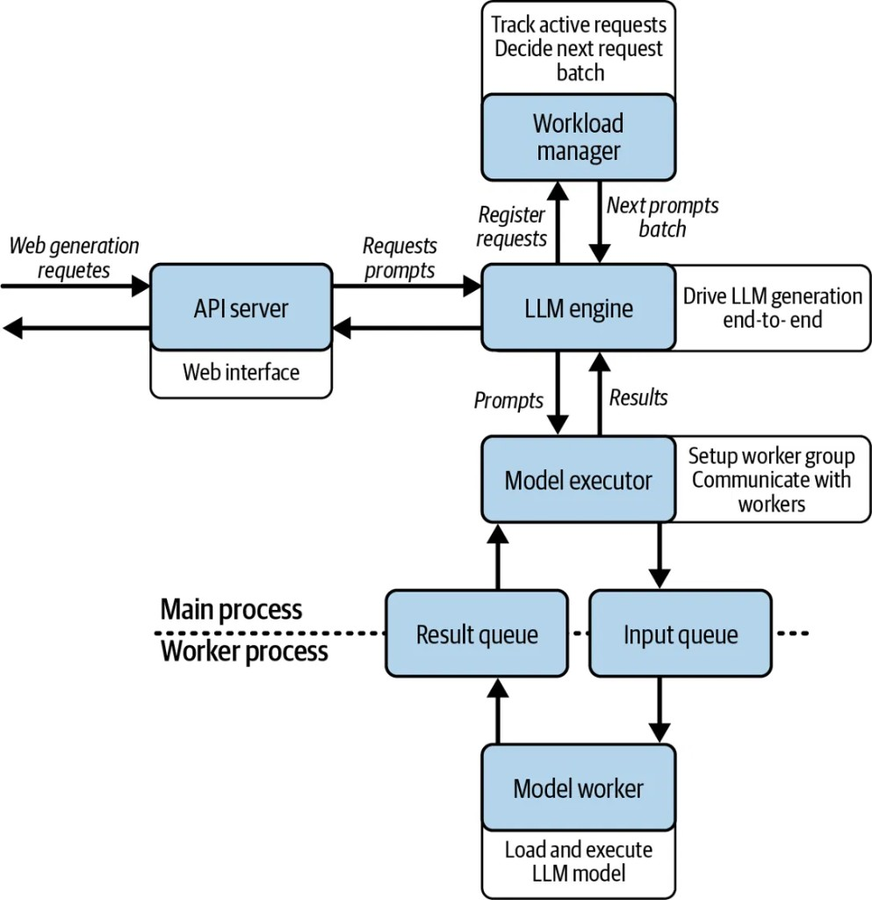
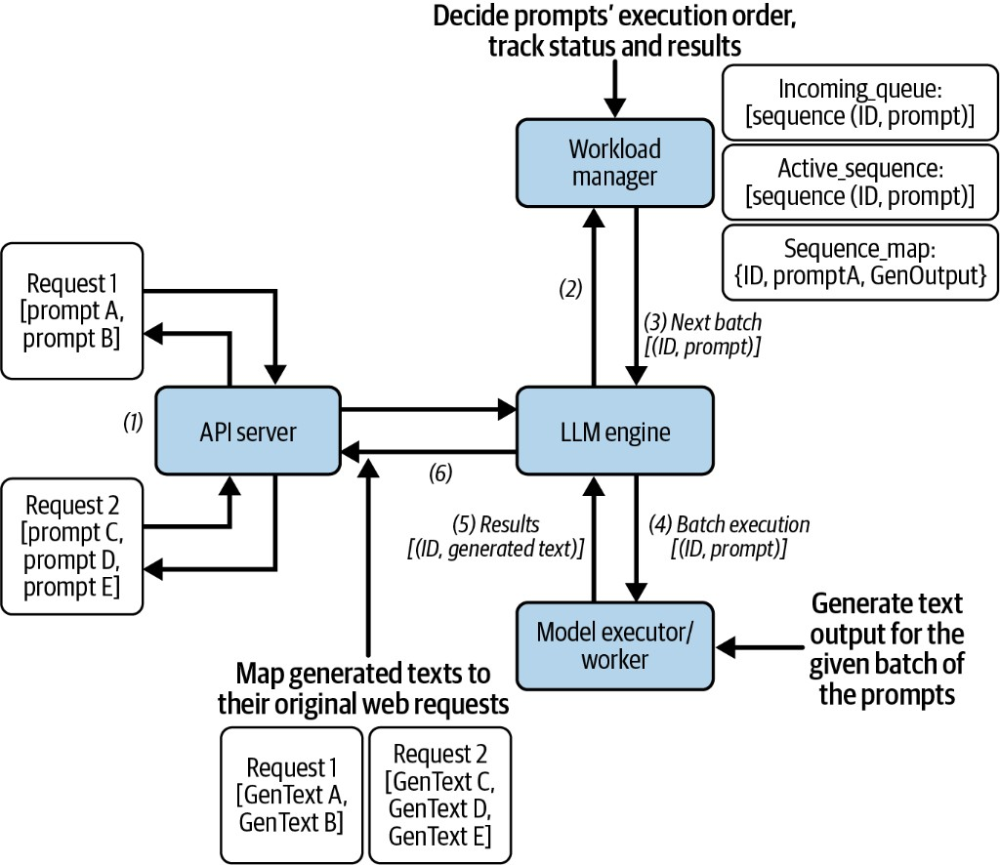
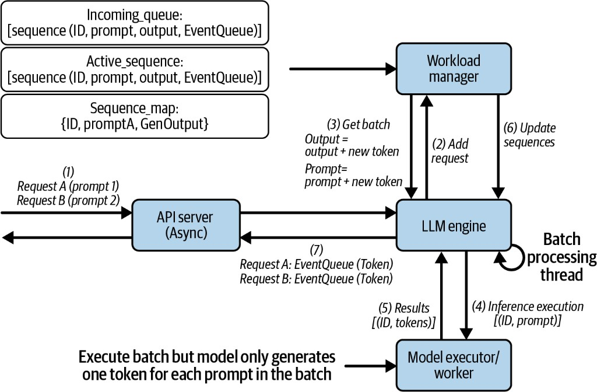
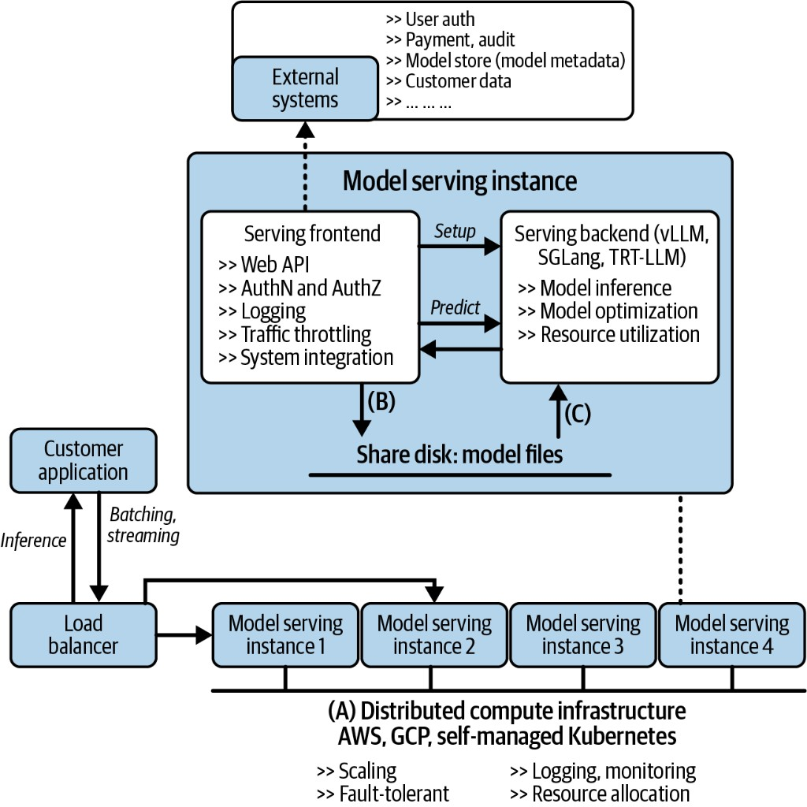
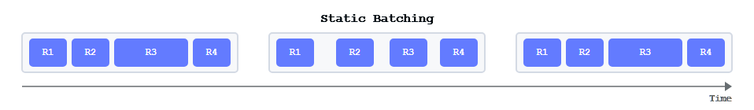
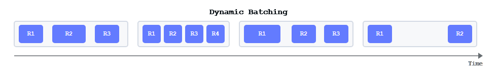
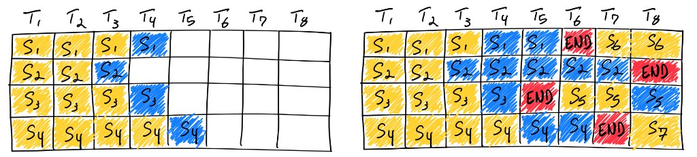

A fast forward pass is one component of a service. Requests arrive at different times, consume different amounts of memory, and finish at different lengths. The serving system turns that irregular demand into batches while managing admission, streaming, cancellation, and fairness.

## 8.1 Anatomy of a production inference server

### The production inference server around the batch

A request enters through an API layer that validates model identity, applies access and rate limits, and manages delivery. Tokenization converts its text to IDs. The scheduler decides when prompt or decode work can run within token and memory budgets. The executor launches model operations, the KV allocator manages retained state, and the sampler converts output scores into selected tokens.

These components form a feedback loop: each iteration changes request lengths, completion state, and available memory. Streaming must associate outputs with the right request while cancellation and failures release resources. A fast forward pass is necessary, but it is only one component of the serving system.

The batching strategies below explain the scheduler's part of that system. The later server walkthrough exposes the request IDs, queues, and workers in code.

### Restaurant analogy + one simple request

These examples use the repository's [single-model teaching server](https://github.com/rangarajp/rangarajp.github.io/tree/main/notebooks/llm-inference/single_model_llm_serving). Its custom endpoints and FLOW logs are not the public vLLM API. Start the companion lab before running client snippets. Recorded outputs below are historical observations, not measurements from this revision.

Follow a request from HTTP to the GPU and back; the vLLM example later in this section shows the engine-facing API.

Lab: `notebooks/llm-inference/single_model_llm_serving/` — start the server from `main.ipynb`, call it from `test.ipynb`. Server FLOW prints (`>>> [Layer]`) match the boxes in the diagrams below.

Checkpoint paths come from gitignored `notebooks/llm-inference/local_paths.json` (see `local_paths.example.json`). Absolute machine paths are not published.

Think of serving as a busy kitchen.

| Restaurant | In the stack | Job |
| ---------- | ------------ | --- |
| Customer | Client (`test.ipynb`) | Sends prompt(s) |
| Waiter | FastAPI (API Server) | Takes the order, returns the answer |
| Head chef | LLM Engine | Runs the ticket end-to-end |
| Host | Workload Manager | Queues tickets, forms batches, tracks ids |
| Kitchen manager | Model Executor | Sends work across the pass window |
| Pass window | Input / result queues | Orders out, plates back |
| Cook | Model Worker | Runs the model on GPU |
| Pantry | Model Manager | Loads weights once at open |

<figure>



<figcaption><span class="figure-label">Figure 1.</span> Serving architecture — main process vs worker process</figcaption>
</figure>

```text
Client → FastAPI → LLM Engine → Workload Manager → Model Executor
       → queues → Model Worker → GPU → results back the same way
```

#### Example A — Basic generate (one prompt)

One customer, one dish. From `test.ipynb`:

```python
import httpx

with httpx.Client(proxy=None, trust_env=False) as client:
    response = client.post(
        "http://127.0.0.1:8000/basic_generate",
        json={"prompt": "What is the capital of the United States?"},
        timeout=60.0,
    )

print(response.status_code)
print(response.text)
```

*Client output:*

```text
200
{"generated_text":"What is the capital of the United States? The capital of the United States is Washington, D.C. .."}
```

*Full server FLOW* (connect each line to the picture above):

```text
============================================================
 REQUEST  POST /basic_generate
============================================================
>>> [FastAPI] /basic_generate — prompt='What is the capital of the United States?'
>>> [FastAPI] → LLMEngine.basic_generate()
--- SKIP [WorkloadManager] basic_generate bypasses queue/batching; goes straight to ModelExecutor
>>> [LLMEngine] basic_generate(prompt='What is the capital of the United States?')
--- SKIP [WorkloadManager] basic_generate builds Sequence locally; no add_request / get_next_batch
>>> [LLMEngine] → ModelExecutor.execute_batch([sequence])
>>> [ModelExecutor] execute_batch — sending 1 item(s) to worker (is_streaming=False)
>>> [ModelExecutor] waiting on result_queue…
>>> [ModelWorker] task received — is_streaming=False, batch_size=1
>>> [ModelWorker] generate() — batch size=1
--- SKIP [ModelManager] model already loaded at worker startup; not reloaded per request
>>> [GPU] model.generate() on cuda  input_shape=(1, 9)
>>> [GPU] ← model.generate() finished
>>> [ModelWorker] generate() — returning 1 result(s)
>>> [ModelWorker] result put on result_queue
>>> [ModelExecutor] ← result received from ModelWorker
>>> [LLMEngine] ← result received from ModelExecutor
>>> [FastAPI] ← returning GenerateResponse
============================================================
 DONE     POST /basic_generate
============================================================
```

| Log line | Box on the diagram |
| -------- | ------------------ |
| `[FastAPI]` | API Server / Web Interface |
| `[LLMEngine]` | LLM Engine (head chef) |
| `SKIP [WorkloadManager]` | Host not needed for a single plate |
| `[ModelExecutor]` … `result_queue` | Model Executor + queues on the process boundary |
| `[ModelWorker]` / `[GPU]` | Worker process — load/execute model |
| `SKIP [ModelManager]` | Pantry already stocked at startup |

So Example A walks the picture top → bottom → back up, with one sequence and no batching.

### Many prompts and many requests

When more than one prompt is in flight, the engine must *create an id per prompt*, *batch* work for the GPU, then *map results back* and *remove* finished sequences. That is what the workload picture shows:

<figure>



<figcaption><span class="figure-label">Figure 2.</span> Workload manager: requests → ids → batch → map results back</figcaption>
</figure>

#### Example B — One HTTP request, four prompts

```python
payload = {
    "prompts": [
        "The capital of France is",
        "The capital of India is",
        "The capital of Japan is",
        "The largest planet is",
    ]
}

with httpx.Client(trust_env=False) as client:
    response = client.post(
        "http://127.0.0.1:8000/generate",
        json=payload,
        timeout=60.0,
    )

print(response.status_code)
print(response.json())
```

*Client output (shape):*

```text
200
{
  "generated_texts": [
    "The capital of France is Paris. ..",
    "The capital of India is ..",
    "The capital of Japan is ..",
    "The largest planet is .."
  ]
}
```

*Full server FLOW:*

<details>
<summary>Recorded lab trace</summary>

```text
============================================================
 REQUEST  POST /generate
============================================================
>>> [FastAPI] /generate — 4 prompts
>>> [FastAPI] → LLMEngine.generate()  [uses WorkloadManager batching]
>>> [LLMEngine] generate(4 prompts) — uses WorkloadManager
>>> [WorkloadManager] add_request → incoming_queue  id=7a0a61c3… prompt='The capital of France is'
>>> [WorkloadManager] add_request → incoming_queue  id=006cff72… prompt='The capital of India is'
>>> [WorkloadManager] add_request → incoming_queue  id=b0c77899… prompt='The capital of Japan is'
>>> [WorkloadManager] add_request → incoming_queue  id=d46619e1… prompt='The largest planet is'
>>> [WorkloadManager] get_next_batch(batch) — pulled 4, active=4
>>> [LLMEngine] batch loop — 4 seq(s) → ModelExecutor.execute_batch()
>>> [ModelExecutor] execute_batch — sending 4 item(s) to worker (is_streaming=False)
>>> [ModelExecutor] waiting on result_queue…
>>> [ModelWorker] task received — is_streaming=False, batch_size=4
>>> [ModelWorker] generate() — batch size=4
--- SKIP [ModelManager] model already loaded at worker startup; not reloaded per request
>>> [GPU] model.generate() on cuda  input_shape=(4, 5)
>>> [GPU] ← model.generate() finished
>>> [ModelWorker] generate() — returning 4 result(s)
>>> [ModelWorker] result put on result_queue
>>> [ModelExecutor] ← result received from ModelWorker
>>> [WorkloadManager] update_sequence_output id=7a0a61c3… finished=True tokens=1
>>> [WorkloadManager] update_sequence_output id=006cff72… finished=True tokens=1
>>> [WorkloadManager] update_sequence_output id=b0c77899… finished=True tokens=1
>>> [WorkloadManager] update_sequence_output id=d46619e1… finished=True tokens=1
>>> [WorkloadManager] remove_finished_sequence id=7a0a61c3…
>>> [WorkloadManager] remove_finished_sequence id=006cff72…
>>> [WorkloadManager] remove_finished_sequence id=b0c77899…
>>> [WorkloadManager] remove_finished_sequence id=d46619e1…
>>> [LLMEngine] ← returning 4 generated texts
>>> [FastAPI] ← returning BatchGenerateResponse
============================================================
 DONE     POST /generate
============================================================
```

</details>
#### Server flow in detail (ids: create → send → update → remove)

This is the numbered path on the workload diagram, lined up with Example B’s log:

*1. API Server receives the web request*  
Waiter gets `Request 1` with prompts A–D (or several overlapping requests).

*2. LLM Engine registers each prompt*  
`add_request` creates a UUID *id*, builds a `Sequence(id, prompt)`, puts it on `incoming_queue`, and stores it in `sequence_map`.

```text
>>> [WorkloadManager] add_request → incoming_queue  id=7a0a61c3… prompt='The capital of France is'
… (one line per prompt)
```

*3. Engine asks for the next batch*  
Host moves sequences from `incoming_queue` into `active_sequences` (up to `batch_size=4`) and returns `[(id, prompt), …]`.

```text
>>> [WorkloadManager] get_next_batch(batch) — pulled 4, active=4
```

*4. Batch execution*  
Engine sends that list to Model Executor → Worker. The GPU never needs to know about HTTP — only `(id, prompt)`.

```text
>>> [ModelExecutor] execute_batch — sending 4 item(s) to worker
>>> [GPU] model.generate() on cuda  input_shape=(4, 5)
```

*5. Results come back tagged by id*  
Worker returns `[(id, generated_text), …]`.

*6. Update `sequence_map`, then remove*  
Engine writes each result into `sequence_map[id]`, then drops finished ids from active lists and the map. Finally it walks the original id list to build `generated_texts` in the right order for the API.

```text
>>> [WorkloadManager] update_sequence_output id=7a0a61c3… finished=True
>>> [WorkloadManager] remove_finished_sequence id=7a0a61c3…
>>> [LLMEngine] ← returning 4 generated texts
>>> [FastAPI] ← returning BatchGenerateResponse
```

*Create id → queue → batch → model → update by id → remove id → map to HTTP response.*  
That loop is how nothing is lost or swapped when many prompts share one GPU call.

#### Example C — Many HTTP requests at once

Four clients call `/basic_generate` in parallel (`test.ipynb`):

```python
prompts = [
    "What is KV cache?",
    "What is attention?",
    "What is speculative decoding?",
    "What is continuous batching?",
]

async def call_api(prompt):
    async with httpx.AsyncClient(trust_env=False) as client:
        start = time.perf_counter()
        r = await client.post(
            "http://127.0.0.1:8000/basic_generate",
            json={"prompt": prompt},
            timeout=60.0,
        )
        return {
            "prompt": prompt,
            "time": round(time.perf_counter() - start, 2),
            "response": r.json(),
        }

results = await asyncio.gather(*[call_api(p) for p in prompts])
```

*Client output:*

```text
{'prompt': 'What is KV cache?',             'time': 1.61, ...}
{'prompt': 'What is attention?',            'time': 3.04, ...}
{'prompt': 'What is speculative decoding?', 'time': 4.45, ...}
{'prompt': 'What is continuous batching?',  'time': 5.86, ...}
```

On the server you see *four separate* `REQUEST  POST /basic_generate` FLOW blocks (same pattern as Example A). Each connection owns its own reply.

| | Example B | Example C |
| - | --------- | --------- |
| HTTP | 1 request, 4 prompts | 4 requests, 1 prompt each |
| Ids + Host queue | Yes — see FLOW `add_request` / `remove_finished_sequence` | Each call is independent |
| GPU | One batch `input_shape=(4, …)` | Separate generates (times add up) |

In a production *vLLM* server, concurrent calls like C are continuously batched with the same id discipline as the second diagram — Request 1 and Request 2 share the kitchen; ids keep answers attached when mapping back.

### Streaming — one token per batch step

Batch generate waits for the *full* text. Streaming returns *tokens as they are produced*. The continuous loop looks like this:

<figure>



<figcaption><span class="figure-label">Figure 3.</span> Streaming / continuous batch loop — EventQueue per request</figcaption>
</figure>

#### What the figure is saying

| Step | Meaning |
| ---- | ------- |
| (1) | API Server (async) accepts Request A and Request B |
| (2) | Engine *Add Request* — each gets an id, lands in `incoming_queue` / `sequence_map` (with an *EventQueue* for that client) |
| (3) | Batch-processing thread *Get Batch* of active sequences |
| (4)–(5) | Model Executor runs the batch but generates *only one new token per prompt* |
| (6) | *Update Sequences* — append token; grow `output` / prompt context |
| (7) | Push token into that sequence’s *EventQueue*; API streams it to the client |

Two requests stay on the same loop; ids + EventQueues keep tokens on the right wire.

#### Example — `POST /generate_stream` (`test.ipynb`)

```python
import json
import httpx

prompt = "What is the capital of the United States?"
tokens = []
sequence_ids = set()

with httpx.Client(trust_env=False) as client:
    with client.stream(
        "POST",
        "http://127.0.0.1:8000/generate_stream",
        json={"prompt": prompt},
        timeout=120.0,
    ) as response:
        print("status:", response.status_code)
        for line in response.iter_lines():
            if not line or not line.startswith("data: "):
                continue
            data = json.loads(line[6:])
            token = data["token"]
            seq_id = data["sequence_id"]
            tokens.append(token)
            sequence_ids.add(seq_id)
            print(token, end="", flush=True)

print("\n")
print("sequence_id:", sequence_ids)
print("num tokens:", len(tokens))
print("full text:", prompt + "".join(tokens))
```

*Client output (from the lab):*

```text
status: 200
 Washington, D.C. is the capital of the United States. It is located on the National Mall in

sequence_id: {'bf1b87d8-a261-481e-9e2a-08831607bb11'}
num tokens: 21
full text: What is the capital of the United States? Washington, D.C. is the capital of the United States. It is located on the National Mall in
```

One `sequence_id` for all 21 tokens — that is the ticket number on every SSE event (figure step 7).

#### Server FLOW (from `main.ipynb`) — connect to the figure

*Start — figure steps (1)–(2):* create id, EventQueue, enqueue.

```text
============================================================
 REQUEST  POST /generate_stream
============================================================
>>> [FastAPI] /generate_stream — prompt='What is the capital of the United States?'
>>> [FastAPI] → LLMEngine.event_generator()  [uses WorkloadManager + streaming loop]
>>> [LLMEngine] event_generator(prompt='What is the capital of the United States?')
>>> [WorkloadManager] add_streaming_request → streaming_queue  id=bf1b87d8…
>>> [LLMEngine] streaming seq bf1b87d8… queued; waiting on client asyncio.Queue
>>> [LLMEngine] (tokens produced asynchronously by requests_processing_loop thread)
>>> [WorkloadManager] get_next_batch(streaming) — pulled 1, active=1
```

*One decode step — figure steps (3)–(7):* one forward, one token, push to EventQueue, update sequence.  
`input_shape` grows `(1, 9) → (1, 10) → …` as the prompt context lengthens.

```text
>>> [LLMEngine] streaming loop — 1 active seq(s) → ModelExecutor.execute_forward_batch()
>>> [ModelExecutor] execute_forward_batch — sending 1 item(s) to worker (is_streaming=True)
>>> [ModelWorker] task received — is_streaming=True, batch_size=1
>>> [ModelWorker] generate_forward_batch() — 1 prompt(s), one token each
--- SKIP [ModelManager] model already loaded; not reloaded per request
>>> [GPU] model forward() on cuda  input_shape=(1, 9)
>>> [GPU] ← forward() + sample finished
>>> [ModelWorker] generate_forward_batch() — returning 1 token(s)
>>> [ModelExecutor] ← streaming result received (type=stream)
>>> [LLMEngine] streaming loop — seq bf1b87d8… token=' Washington' → client queue
>>> [WorkloadManager] update_sequence_output id=bf1b87d8… finished=False tokens=1
```

Next iterations (same pattern; tokens from the run):

```text
… token=','          tokens=2   input_shape=(1, 10)
… token=' D'         tokens=3
… token='.C'         tokens=4
… token='.'          tokens=5
… token=' is'        tokens=6
… token=' the'       tokens=7
… token=' capital'   tokens=8
… token=' of'        tokens=9
… token=' the'       tokens=10
… token=' United'    tokens=11
… token=' States'    tokens=12
… token='.'          tokens=13
… token=' It'        tokens=14
… token=' is'        tokens=15
… token=' located'   tokens=16
… token=' on'        tokens=17
… token=' the'       tokens=18
… token=' National'  tokens=19
… token=' Mall'      tokens=20
… token=' in'        tokens=21   input_shape=(1, 29)
```

*Finish — remove id* (same lifecycle as batch generate):

```text
>>> [LLMEngine] streaming loop — seq bf1b87d8… finished → put None on client queue
>>> [WorkloadManager] remove_finished_sequence id=bf1b87d8…
>>> [LLMEngine] event_generator — end of stream for seq bf1b87d8…
>>> [LLMEngine] event_generator — cleaned up seq bf1b87d8…
============================================================
 DONE     POST /generate_stream
============================================================
```

| Log / client | Figure |
| ------------ | ------ |
| `add_streaming_request … id=bf1b87d8` | (2) Add Request + id |
| `get_next_batch(streaming)` / `streaming loop` | (3) Get Batch (batch thread) |
| `execute_forward_batch` / `generate_forward_batch` / `GPU forward` | (4)–(5) one token per prompt |
| `update_sequence_output … tokens=N` | (6) Update Sequences |
| `token='…' → client queue` + client prints tokens | (7) EventQueue → API stream |
| `remove_finished_sequence` / `end of stream` | ticket closed |

#### Code path in the lab

*Waiter* — FastAPI SSE (`main.ipynb` / `main.py`):

```python
@app.post("/generate_stream")
async def generate_stream(request: GenerateRequest, llm: LLMEngine = Depends(get_llm)):
    async def event_generator():
        loop = asyncio.get_event_loop()
        async for token in llm.event_generator(loop, request.prompt):
            yield token
    return StreamingResponse(event_generator(), media_type="text/event-stream")
```

*Head chef* — EventQueue + wait for tokens (`llm/llm.py`):

```python
async def event_generator(self, loop, prompt: str):
    queue = asyncio.Queue()  # EventQueue in the figure
    seq_id = self.workload_manager.add_streaming_request(prompt, queue, loop)
    while True:
        data = await queue.get()
        if data is None:
            break
        yield f"data: {data}\n\n"
    self.workload_manager.remove_finished_sequence(seq_id)
```

*Batch-processing thread* — figure steps 3–7 (`requests_processing_loop`):

```python
active = workload_manager.get_next_batch(is_streaming=True)
results = model_executor.execute_forward_batch(
    [{"prompt": seq.prompt, "request_id": seq.id} for seq in active]
)
for result in results:
    seq.client_stream.put(json.dumps({
        "token": result["token"],
        "sequence_id": result["request_id"],  # same id client prints
    }))
    workload_manager.update_sequence_output(result["request_id"], result["token"])
```

When finished (EOS or `max_tokens`), put `None` on the queue and *remove* the sequence.

### Takeaways

1. *Example A* walks the architecture diagram with a full FLOW log — waiter → chef → executor → worker → GPU and back.  
2. *Many prompts / requests* need *ids*: create on `add_request`, send in the batch, update `sequence_map`, then *remove* when done.  
3. *Example B* is one request with many prompts batched together; *Example C* is many requests at once — production vLLM merges those with the same id discipline.  
4. *Streaming* (`bf1b87d8…`, 21 tokens in the lab): same Host + *one GPU forward per token*; EventQueue delivers SSE; id is created, updated each step, then removed.

### Scaling out: single-model serving architecture

The lab above is *one process, one model*. In production you usually replicate that pattern across a cluster. A common layout looks like this:

<figure>



<figcaption><span class="figure-label">Figure 4.</span> Single-model serving architecture — load balancer, frontend, backend, shared disk</figcaption>
</figure>

#### Layers

| Layer | Role |
| ----- | ---- |
| Customer application | Sends inference / streaming requests |
| Load balancer | Spreads traffic across serving instances |
| Serving frontend | Web API, AuthN/AuthZ, logging, throttling, integration with external systems |
| Serving backend | Inference engines (vLLM, SGLang, TRT-LLM) — run the model, optimize, use GPU |
| Shared disk | Model weight files visible to every instance |
| External systems | User auth, payment/audit, model metadata store, customer data |
| Distributed compute | AWS / GCP / self-managed Kubernetes — scaling, fault tolerance, monitoring |

#### How a request moves

1. App → load balancer → one of N *model serving instances*  
2. *Frontend* authenticates / throttles (via external systems), then issues *Setup* / *Predict* to the backend  
3. *Backend* reads weights from shared disk (or uses an already-loaded engine) and runs inference  
4. Response returns (batch or stream) through the same path  

Labeled paths in the figure:

- *(A)* Instances run on shared distributed compute  
- *(B)* Frontend can stage / discover model files on shared disk  
- *(C)* Backend loads those files for inference  

#### Mapping to this series

| Production box | In the lab stack |
| -------------- | ---------------- |
| Serving frontend | FastAPI API server |
| Serving backend | LLM Engine → Workload Manager → Model Executor → Model Worker (or vLLM) |
| Model files | Local checkpoint under `MODELS_DIR` |

The lab is the *inside of one instance*. The figure is how you *replicate* that instance behind a load balancer when one GPU (or one process) is no longer enough.

### Lifecycle correctness beyond the teaching server

Sequence IDs must survive queueing, batching, streaming, and result fan-out. Cancellation should mark work for removal, release the sequence's KV blocks, and stop delivery. A worker failure must fail outstanding requests rather than leave callers waiting forever. Backpressure bounds both the waiting queue and active cache reservations.

The lab illustrates the control flow. Continuous batching in a production engine is a token-iteration scheduler; a wrapper around independent blocking `generate` calls is not sufficient to implement it.

### vLLM: all of this managed for you

Start with a supported GPU installation of vLLM. This chapter adapts the original [vLLM notebook](https://github.com/rangarajp/rangarajp.github.io/blob/main/notebooks/llm-inference/basic_vLLM_v1.ipynb). Its recorded environment used vLLM 0.6.1.post1; the basic `LLM`/`SamplingParams` interface remains the entry point, while internal async APIs differ by release.

Manually managing K/V tensors, handling multiple concurrent users, and keeping the GPU busy is a significant engineering job. *vLLM* is an inference engine that handles it — you write prompts and sampling parameters, it handles the rest.

#### Load once, reuse everywhere

```python
from vllm import LLM, SamplingParams
MODEL_PATH = "Qwen/Qwen2.5-0.5B-Instruct"  # or an existing local snapshot directory

llm = LLM(
    model=MODEL_PATH,
    dtype="float16",
    gpu_memory_utilization=0.30,
    max_model_len=2048,
    max_num_seqs=8,
)
```

Weights load once — ≈ 0.93 GB for this 0.5B model. vLLM then pre-allocates a *paged KV block pool* so it can serve many concurrent requests without memory fragmentation.

| Knob | Role |
| ---- | ---- |
| `dtype` | Weight precision |
| `gpu_memory_utilization` | Fraction of GPU for weights + KV blocks |
| `max_model_len` | Max prompt + generation length |
| `max_num_seqs` | Max concurrent sequences in one batch |

#### First completion

```python
params = SamplingParams(temperature=0.8, top_p=0.95, max_tokens=128)
prompt = "Explain why a battery needs cooling in one sentence."
outputs = llm.generate([prompt], params)
text = outputs[0].outputs[0].text
```

*Run output:*
```
prompt tokens ~ 29
new tokens    = 128

est. speed input: 48.53 toks/s, output: 214.20 toks/s
```

The call blocks until all 128 tokens are ready. Fine for batch jobs.

#### Sampling knobs

`SamplingParams` controls *how* you draw from the next-token distribution — the model weights stay fixed.

| Param | Effect |
| ----- | ------ |
| `temperature` | Higher → more random; `0` = greedy (always pick highest probability) |
| `top_p` | Keep smallest token set covering p% of probability mass |
| `top_k` | Keep only the top-k most probable tokens |
| `max_tokens` | Stop after this many new tokens |
| `stop` | Stop on specific strings (e.g. `["\n"]`) |

*Same prompt, two settings — from the run:*

```
[greedy (T=0)]    The capital of France is Paris. It is the largest city in
                  Europe and the third largest city in the world...

[creative (T=1.0)] The capital of France is:
                   A) Paris
                   B) London
                   C) Berlin
                   D) Moscow
                   To determine the capital of France...
```

Same model. Same weights. Entirely different output character.

#### Batching: one of the biggest wins

vLLM can run multiple prompts through shared scheduled model iterations. The scheduler can combine their work and reuse loaded weights. Occupancy and speedup depend on shapes and hardware.

*Measured:*

```
4 prompts in one batch : 0.379s   (~688 output tokens/s)
4 prompts one-by-one   : 1.145s   (~226 output tokens/s)
speedup                : 3.02×
```

These numbers belong to the original small-model notebook run, not a guarantee for other workloads. The high-level API accepts a list of prompts; compare that batch with sequential calls using matched output lengths and warmup.

### Serve and stream through the HTTP API

```bash
vllm serve Qwen/Qwen2.5-0.5B-Instruct --dtype float16 --max-model-len 2048
```

With the server running, this client consumes OpenAI-compatible server-sent events and prints content deltas. It does not assume that one HTTP chunk equals one token.

```python
import json
import httpx

with httpx.Client(timeout=120.0) as client:
    with client.stream("POST", "http://127.0.0.1:8000/v1/chat/completions", json={
        "model": "Qwen/Qwen2.5-0.5B-Instruct",
        "messages": [{"role": "user", "content": "Explain KV caching briefly."}],
        "max_tokens": 128, "temperature": 0, "stream": True,
    }) as response:
        response.raise_for_status()
        for line in response.iter_lines():
            if not line.startswith("data: "):
                continue
            payload = line[6:]
            if payload == "[DONE]":
                break
            event = json.loads(payload)
            for choice in event.get("choices", []):
                print(choice.get("delta", {}).get("content") or "", end="", flush=True)
print()
```

Model download, GPU memory, dtype, and attention kernels must be compatible with the environment. Some GPUs do not support BF16 or FP8. Match the engine version to the model rather than changing flags until it happens to load.

### What the engine manages

The scheduler selects request work; the allocator assigns KV blocks; the executor runs model operations; sampling updates sequence state; delivery streams results to the caller. Prefix caching reuses identical prompt state, while paging manages its placement. A request ending early must release its reservation.

Engine configuration names and defaults vary by version. Record model revision, runtime version, token budgets, KV dtype, and warmup in every benchmark. See [the official quickstart](https://docs.vllm.ai/en/latest/getting_started/quickstart/) and [OpenAI-compatible serving](https://docs.vllm.ai/en/latest/serving/openai_compatible_server/).

## 8.2 Batching strategies

### The boat — requests as passengers, the GPU as a ferry

Think of the GPU as a ferry that runs short trips in a loop. Each trip is one *iteration*: a forward pass that advances every passenger currently on board.

| Boat world | Inference world |
| ---------- | --------------- |
| Ferry / boat | GPU running one batched forward |
| Passenger | One request / sequence |
| Seat | Slot in the current batch (`max_num_seqs`, memory for that seq’s KV) |
| Dock / waiting line | Admission queue |
| Boarding | Prefill — process the prompt, build KV |
| Riding between stops | Decode — one new token per trip |
| Getting off | EOS / max tokens / client cancel |
| Ticket id | Sequence id (so the right answer returns to the right client) |

The captain’s job is not “make one perfect trip.” It is *keep seats useful*: pick up waiting passengers when a seat frees, drop finished ones immediately, and do not let one slow boarding freeze the whole route.

### Why batching is needed

A transformer forward pass loads the same weights from HBM whether you run *1* sequence or *N*. Decode is usually *memory-bandwidth bound*: most of the time is moving weights, not doing math on one token.

So with one passenger alone on a big boat:

- You still pay the full weight-load cost every decode step  
- Most seats are empty  
- Tokens/sec for the *fleet* (throughput) stay low even if that one rider feels fine  

Batching puts several passengers on the same trip. One weight load serves many sequences. Cost per token falls; GPU utilization rises.

```text
1 passenger alone     →  pay full trip cost for 1 token
8 passengers together →  pay ~same trip cost for 8 tokens
```

That is the whole economic case for batching: *amortize weight traffic across concurrent sequences*.

Batching also matters in prefill. Larger effective batch / token counts make matmuls fatter and more compute-bound — which is where TFLOPS actually help (see [GPU Architecture](./gpu-fundamentals)).

### Static batching — wait for a fixed-size group

The simplest form of batching is *static batching*. The server waits until a fixed number of requests arrive, then processes them together as one batch. Nothing new boards until that whole group is done.

<figure>



<figcaption><span class="figure-label">Figure 5.</span> Static batching: fixed-size batches processed one after another</figcaption>
</figure>

*How it runs:*

1. Collect up to $B$ prompts from the queue  
2. Pad them to the same length  
3. Run prefill + decode until *all* sequences in that batch are done  
4. Only then admit the next batch  

While static batching is easy to implement, it has notable downsides.

- *First request waits for the last.* The earliest arrival in a batch is forced to wait until the batch fills — like a printer that will not start until a fixed number of documents are queued, no matter how long the last one takes to arrive.  
- *Uneven work inside the batch.* In LLM inference some requests finish in a few tokens; others run long chain-of-thought. Everyone waits for the slowest sequence, so seats sit idle after short requests finish and latency climbs.  

*Boat picture:* eight tourists board together. One wants a 2-stop hop; another wants a 200-stop cruise. The ferry will not drop the short rider at stop 2 and free that seat. Everyone stays on until the longest trip ends. New tourists on the dock watch an almost-empty boat cruise past because the charter rules say “same group only.”

#### What hurts in practice

| Problem | On the boat | On the GPU |
| ------- | ----------- | ---------- |
| Uneven *generation* length | Short trips stuck until the longest ends | Early-finished sequences idle in the batch; seats wasted |
| Uneven *prompt* length | Some bring huge luggage, some a backpack | Pad to `max_len` in the batch → fake tokens, wasted compute/memory |
| Late arrivals | Cannot board mid-voyage | New requests wait for the whole static batch to drain |
| Latency tails | One long cruise defines everyone’s return time | p99 latency dominated by the slowest sequence in the batch |

Padding is the silent tax. If prompts are lengths `[8, 8, 8, 512]`, a naive tensor batch shaped `(4, 512)` spends most of its work on pad positions that mean nothing — empty seats with sandbags so the rows “look” rectangular.

Static batching is fine for offline jobs where you already have a pile of prompts and care about throughput, not interactive latency. It is a poor fit for a live API.

### Dynamic batching — leave on a timer or when full

*Dynamic batching* still groups requests into batches, but it does not insist on a fixed size. It sets a time window and processes whatever has arrived by then. If the batch hits its size limit sooner, it launches immediately — like a bus that leaves on a schedule *or* when it is full, whichever comes first.

<figure>



<figcaption><span class="figure-label">Figure 6.</span> Dynamic batching: batch size varies with arrivals</figcaption>
</figure>

Dynamic batching balances throughput and latency better than static: early requests are not delayed indefinitely waiting for a full charter. The trade-offs remain:

- Batches may launch underfull, so GPU efficiency is not always maxed  
- Like static batching, the *longest* request in a batch still defines when the batch finishes — short requests wait for that slowest member before the next group can start  

So dynamic batching softens the “wait forever to fill” problem. It does not fix uneven generation lengths inside a closed batch.

### Continuous batching — pick up and drop off every stop

For LLM inference, output lengths vary widely. Static and dynamic batching keep short requests stuck until the longest one in the *same closed batch* finishes. That leaves GPU seats unsaturated.

*Continuous batching* (also called *in-flight* or *iteration-level* batching) addresses that. It does not force the entire batch to complete before returning results. Each sequence finishes independently; as soon as one slot frees, the server inserts a new request. Think of an assembly line: as soon as one item is done, a new one takes its place so the line stays full.

<figure>



<figcaption><span class="figure-label">Figure 7.</span> Generating seven sequences with continuous batching — finished slots are replaced in-flight (right) instead of staying empty (left). Source: Anyscale</figcaption>
</figure>

*Rules of the modern ferry:*

1. After *every* decode trip, check who finished → *drop them off*, free their seat and KV  
2. If seats (and memory) remain, *pick up* waiting passengers from the dock  
3. New passengers may need boarding (prefill) while others are already riding (decode)  
4. The boat never waits for the original group to finish together  

```text
Iteration t:   [A decode] [B decode] [C decode] [D decode]
               C reaches EOS → drop C
Iteration t+1: [A decode] [B decode] [E prefill/decode] [D decode]
               E boarded into C’s freed seat
```

*Boat picture:* the ferry runs a tight loop of short hops. At each pier it lets people off who reached their stop and lets new people on if a seat is free. A two-stop rider does not hostage a two-hundred-stop rider. The dock clears steadily instead of in giant charter waves.

| Static / dynamic | Continuous batching |
| ---------------- | ------------------- |
| Batch membership fixed until all in the group are done | Membership changes every iteration |
| Seat freed only at end of that closed batch | Seat freed at EOS / cancel |
| Great for offline bulk / simple servers | Default for interactive serving (vLLM, TGI, TensorRT-LLM, …) |
| Padding + idle early finishers | Running set stays closer to “full useful seats” |

This is why production engines talk about `max_num_seqs` and KV memory pools rather than “batch size 32 until done.” The boat’s capacity is a *ceiling on concurrent passengers*, not a fixed tour group.

#### What continuous batching does *not* remove

Passengers still have different luggage sizes (prompt lengths) and different destinations (output lengths). Continuous batching fixes *when* you can pick up and drop off. You still need a plan for *boarding* so a single tourist with a shipping container of luggage does not block the gangway for everyone else. That plan is chunked prefill.

### Prefill vs decode on the same boat

Recall two phases per passenger:

| Phase | Work | Feels like |
| ----- | ---- | ---------- |
| Prefill | Process all prompt tokens, write KV | Heavy boarding — many bags through the gate |
| Decode | One new token, read KV + weights | Light hop — passenger already seated |

Decode wants many seated passengers sharing each weight load. Prefill wants lots of tokens to chew through at once. Mixing them carelessly creates a classic failure mode:

*Head-of-line blocking on the gangway.*  
A new passenger arrives with a 8k-token prompt. If the engine runs that entire prefill in one blocking chunk, every already-seated rider waits — no decode tokens stream to them — until boarding finishes. Time-to-first-token for the new rider may look fine while *everyone else’s* token stream stalls.

Boat picture: the ferry is mid-route with 20 happy passengers. One new tourist shows up with a container load. If the crew insists on loading the entire container before the next hop, those 20 riders sit dead in the water. Efficient pick-and-drop dies at the dock.

### Chunked prefill — board luggage in pieces

Chunked prefill splits a long prompt into token chunks (e.g. 512 or 2048 at a time). Between chunks, the engine can still run decode steps for passengers already on board.

*Rules:*

1. Cap how many *prefill tokens* you admit in one iteration (`max_num_batched_tokens` style budgets)  
2. Spend some of that budget on decode tokens for active riders (often prioritized so streams stay smooth)  
3. Spend the rest on the next chunk of boarding for new / partially prefilling sequences  
4. Repeat until the new passenger’s prompt is fully boarded (KV complete), then they join normal decode rides  

```text
Iteration:  decode(A,B,C) + prefill_chunk(D, tokens 0..511)
Iteration:  decode(A,B,C) + prefill_chunk(D, tokens 512..1023)
Iteration:  decode(A,B,C,D)   ← D fully boarded, now a normal rider
```

*Boat picture:* the container is loaded *crate by crate*. Between crates, the ferry still makes its short hops — existing passengers keep moving toward their stops. New boarding progresses without turning the route into a blocked cargo operation.

| Without chunked prefill | With chunked prefill |
| ----------------------- | -------------------- |
| One long prefill monopolizes an iteration (or many) | Prefill work is budgeted per iteration |
| Active decodes stall → latency spikes for everyone | Decodes keep getting seats on each trip |
| Unpredictable interference when long prompts arrive | Smoother TTFT / TPOT trade-off under mixed traffic |

Chunked prefill is how you keep *efficient pick and drop* when the dock has both day-trippers (short prompts) and freight (long contexts).

### Putting the route together

End-to-end, a well-run inference ferry looks like this:

```text
                    ┌──────────── dock (queue) ────────────┐
                    │  waiting passengers (new requests)   │
                    └───────────────┬──────────────────────┘
                                    │ pick up if seat + KV free
                                    ▼
              ┌─────────────────────────────────────────────┐
              │              boat (GPU batch)               │
              │  seats: partial prefill | decode riders     │
              │  each iteration: drop EOS, chunk-board, hop │
              └─────────────────────────────────────────────┘
                                    │
                    drop off finished → free seat + KV → next pick up
```

*Design checklist*

1. *Batch* — never run the big ferry for one rider if others are waiting and memory allows  
2. *Continuous* — re-form the passenger list every iteration; drop finished, pick new  
3. *Chunk prefill* — board long prompts in budgets so decode riders keep moving  
4. *Cap seats by memory* — KV cache is the real seat belt count, not a vanity batch size  
5. *Track tickets* — sequence ids so pick/drop never mix up who gets which answer  

Static batching is a charter bus. Dynamic batching is a bus that leaves on a timer or when full. Continuous batching is a city ferry with open boarding. Chunked prefill is the rule that freight loads in stages so the ferry schedule still serves everyone.

### Simulate iteration-level admission

```python
# Toy decode scheduler: one token per active request per tick.
from collections import deque
waiting = deque([['A', 2], ['B', 5], ['C', 1]])
active, tick = [], 0
while waiting or active:
    while waiting and len(active) < 2:
        active.append(waiting.popleft())
    tick += 1
    print(tick, [name for name, remaining in active])
    active = [[name, remaining-1] for name, remaining in active if remaining > 1]
```

The toy assumes prefill is complete and ignores memory. Reserve growing KV capacity before admitting requests.

### Batching

Continuous / in-flight batching changes the *effective* $B$ that appears in the matrix-intensity calculations in hardware foundations without waiting for a static batch to fill.

- Static batching — pad to a fixed $B$; padding wastes both FLOPs and KV slots.
- Continuous batching — sequences join/leave every step; the token budget (not request count) is the real control knob.
- Prefill vs decode mixing — a large prefill can delay waiting requests and widen gaps in already streaming requests; chunked prefill trades TTFT fairness against utilization.

Batching is how you push decode toward the roofline ridge without changing the model. Details: [Batching](./continuous-batching).

## 8.3 Disaggregated prefill and decode

Separate worker pools allow different hardware or batch policies for the two phases. The cost is transferring KV state and coordinating ownership, routing, and failure recovery. If cache transfer is slower than the interference it avoids, disaggregation hurts latency. Prefix placement and network topology affect the result.

## 8.4 SLO-aware scheduling

A latency objective should specify a percentile and workload. Token budgets, aging of queued requests, admission limits, and reserved decode capacity help manage it. An unbounded queue converts overload into extreme tail latency. Explicit rejection or backpressure is often more predictable.

#### Scheduling policies and their costs

FIFO is easy to reason about, but a long admitted prompt can delay short requests. Priority or length-aware scheduling changes who waits; it should include aging or another fairness mechanism to avoid starving expensive work. Estimated output length is uncertain, so predictions are scheduling hints rather than guarantees.

Preemption can make room for urgent work, but retained KV state must be preserved, moved, or recomputed. Those choices consume memory, bandwidth, or compute. Admission control prevents overload from becoming an unbounded queue, while routing can send work to replicas with a more suitable queue or useful cached prefix.

Express the objective in observable terms, such as p95 TTFT and post-first-token pace for a stated workload. Measure the combined compliance of actual requests rather than assuming that two separate percentile targets imply the same joint success rate.

Primary reading: [Sarathi-Serve](https://arxiv.org/abs/2403.02310) and [PagedAttention](https://arxiv.org/abs/2309.06180).

## Recorded notebook observations

These observations come from the saved notebook runs linked below. Their model, timing boundary, and hardware assumptions are part of the result.

### V100 lab: distinguish a batch observation from a scheduler experiment

The [0.5B generation notebook](https://github.com/rangarajp/rangarajp.github.io/blob/main/notebooks/llm-inference/basic_vLLM_v1.ipynb) records four prompts completing in 0.379 s as one batch versus 1.145 s when submitted sequentially on the V100, a 3.02× wall-time ratio. This establishes a batch-versus-sequential observation for that workload. Both paths used a 64-token cap with stochastic sampling, so actual completion lengths can differ. It does not isolate continuous batching from static batching or establish a universal speedup.

The later [mixed chat/long-document notebook](https://github.com/rangarajp/rangarajp.github.io/blob/main/notebooks/llm-inference/observability/experiments/1.1_single_model_performance.ipynb) explicitly notes that its live unchunked run did not show the expected large stall. Some explanatory timelines in that notebook are reconstructed from measured smooth-stream and document-wave durations. Those timelines are simulations; they must not be presented as measured chunked-prefill improvements.

### V100 lab: label the model, engine version, and timing boundary

The original [generation notebook](https://github.com/rangarajp/rangarajp.github.io/blob/main/notebooks/llm-inference/basic_vLLM_v1.ipynb) uses Qwen2.5-0.5B-Instruct on Tesla V100-SXM2-32GB. The saved [server environment](https://github.com/rangarajp/rangarajp.github.io/blob/main/notebooks/llm-inference/single_model_llm_serving/main.ipynb) records vLLM `0.6.1.post1` with PyTorch `2.4.0+cu118`. The batch timings reproduced above belong to that historical setup; the command-line/API example describes the engine interface and is not evidence that the newest release supports Volta.

The basic notebook’s introductory Markdown names a 7B checkpoint, but its saved setup output prints `Qwen2.5-0.5B-Instruct`. The batch figures are therefore presented as historical outputs associated with the printed setup, not as a fresh 7B benchmark. Re-running the notebook requires recording the resolved model path/configuration and actual completion lengths.

For the separate Qwen2.5-7B experiment, the [cache notebook](https://github.com/rangarajp/rangarajp.github.io/blob/main/notebooks/llm-inference/observability/experiments/3.1_kv_cache.ipynb) records a vLLM sample with prefix caching off: TTFT 42.7 ms, end-to-end 1583.5 ms, and 64 output tokens. Its displayed 40.4 tok/s is $64/1.5835$, an end-to-end output rate including startup delay. It is not the reciprocal of steady inter-token latency.

## Hands-on extensions

Use these experiments to connect the mechanisms above to measurements. They are proposed exercises unless a recorded result is explicitly identified.

### Hands-on: separate live stalls from reconstructed timelines

Use the mixed chat/long-document experiment to record actual arrival and token-delivery timestamps. Publish live unchunked and chunked traces with the same load. Keep any reconstructed timeline in a separate figure labeled simulation, especially if the live workload shows little interference.

### Hands-on: trace cancellation and cleanup

Run one basic, one batched, one streamed, and one cancelled request through the teaching server. Publish a request/sequence-ID trace showing admission, execution, delivery, and cleanup. Check that cancelled work releases state and cannot deliver another request’s tokens.

### Hands-on: compare batch and sequential engine calls

Reproduce the original four-prompt comparison using a compatible pinned engine. Report actual generated tokens, wall time, model revision, batch settings, and warmup. Add a streamed-client trace and compare server processing time with client delivery time.
