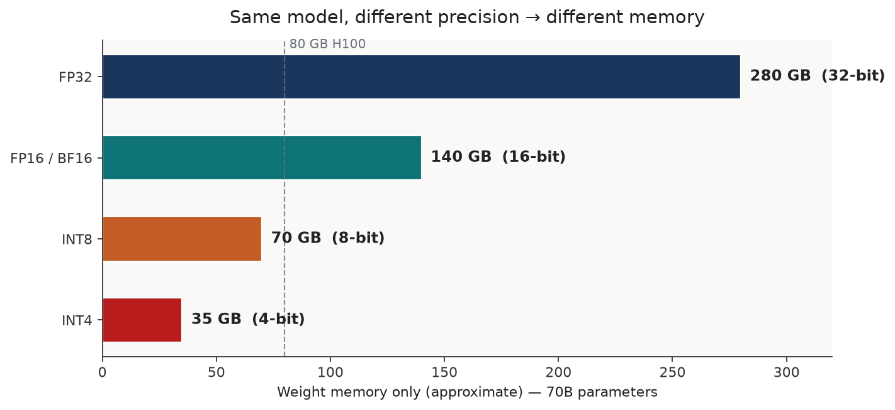
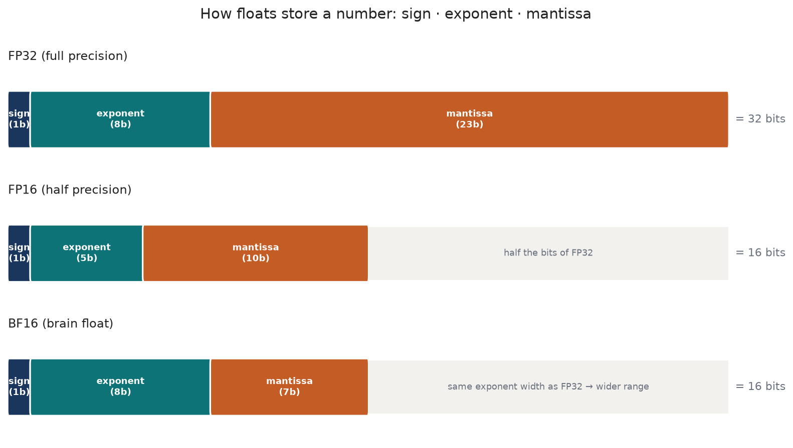
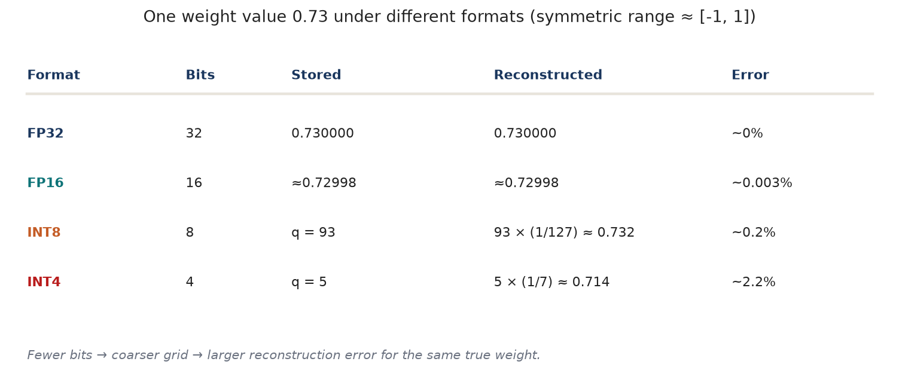
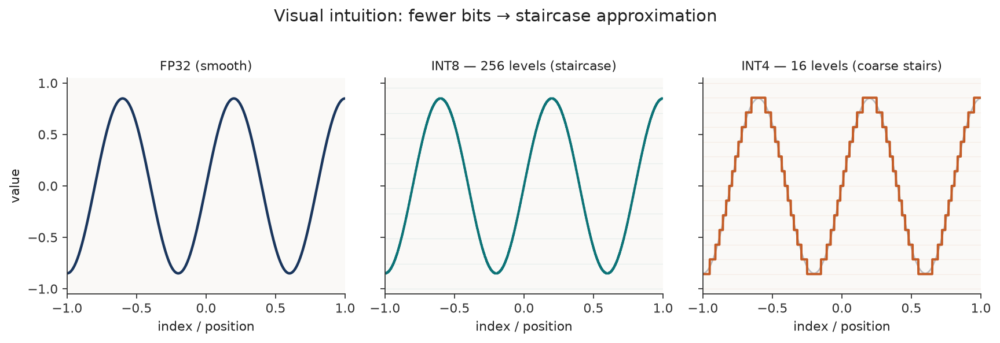
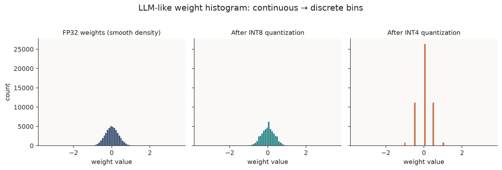
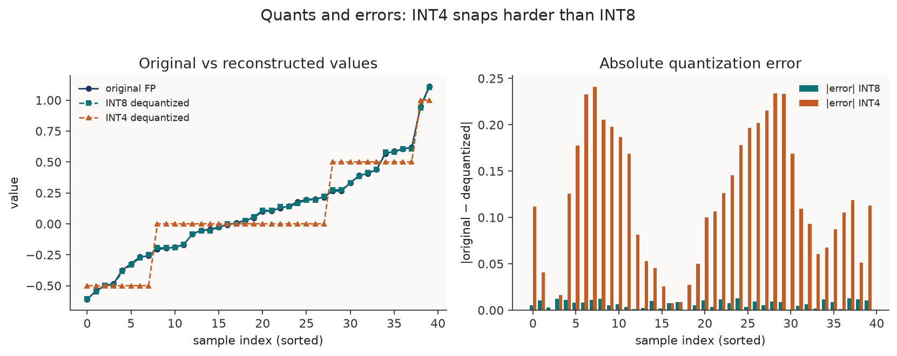
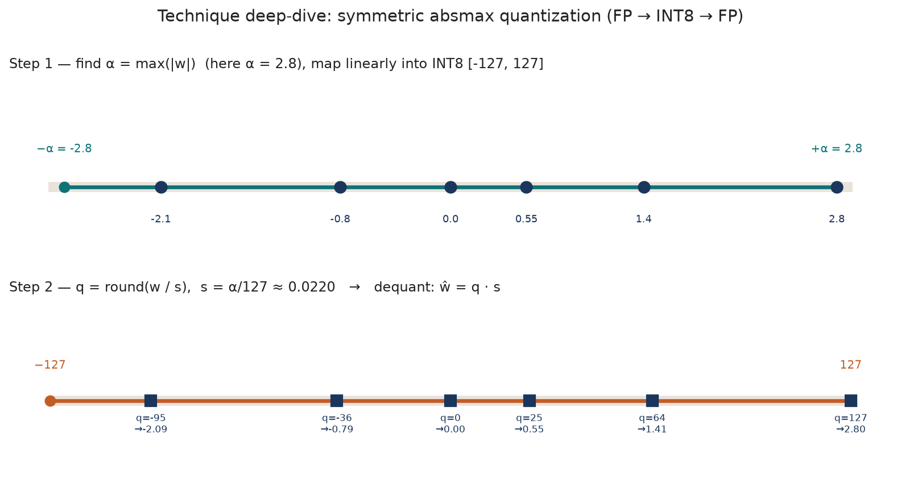

Batching reuses weights across requests. Quantization changes how those weights and activations are represented, reducing storage or traffic when a suitable kernel can exploit the format.

LLMs are “large” mostly because they store billions of numbers. Quantization asks a simple question: can we store each number with fewer bits and still get almost the same answers?

This chapter builds that intuition from bits upward — memory math, float layouts, the staircase picture, weight histograms, quantization error — then walks one technique in detail: *symmetric absmax*.

Inspired by [A Visual Guide to Quantization](https://newsletter.maartengrootendorst.com/p/a-visual-guide-to-quantization) (Maarten Grootendorst) and the walkthrough in [LLM Quantization Explained](https://www.youtube.com/watch?v=37g8S71LfmQ). Figures below are originals drawn for this book.

Related: [GPU memory budgets](./memory-footprint), [batching](./continuous-batching).


## 1. Why quantization — same model, different memory

The *architecture* of a 70B model does not change when you go from FP32 to INT4. The *size of each weight* does.

$$
\text{weight memory (bytes)} \approx \text{parameters} \times \frac{\text{bits per parameter}}{8}
$$

| Precision | Bits / param | ~Memory for 70B weights |
| --------- | ------------ | ----------------------- |
| FP32 | 32 | ~280 GB |
| FP16 / BF16 | 16 | ~140 GB |
| INT8 | 8 | ~70 GB |
| INT4 | 4 | ~35 GB |

<figure>



<figcaption><span class="figure-label">Figure 1.</span> Same 70B model — fewer bits per weight → fits (or fails to fit) on an 80 GB GPU. Weights only; KV cache and activations are extra</figcaption>
</figure>

That is the core pressure: interactive serving wants the model in GPU HBM. If FP16 does not fit, you either shard across GPUs or *shrink the numbers*. Quantization is the shrink.

Lower precision can reduce weight traffic and enable faster supported arithmetic. Neither a twofold prefill speedup nor a twofold decode speedup is guaranteed: packing, scales, dequantization, kernel support, and other memory traffic all contribute.

Trade-off in one line: lower bits → less memory (and often more tokens/sec on bandwidth-bound decode) → more rounding error → possible quality loss.


## 2. Basics — bits, bytes, and how floats store a number

### Bits and bytes

A *bit* is 0 or 1. With $n$ bits you can represent $2^n$ distinct patterns.

| Width | Distinct integer levels (unsigned) |
| ----- | ---------------------------------- |
| 2-bit | $2^2 = 4$ |
| 4-bit | $2^4 = 16$ |
| 8-bit | $2^8 = 256$ |

Eight bits = one *byte*. So FP32 is 4 bytes per value, INT8 is 1 byte, INT4 is half a byte (often packed).

Example: the integer *173* in one byte is `10101101` → $128 + 32 + 8 + 4 + 1$.

### Floating-point layouts (IEEE-style)

A float is not “a decimal with infinite precision.” It is a fixed bit budget split into:

- *sign* — positive or negative  
- *exponent* — where the decimal point sits (the *range*)  
- *mantissa / fraction* — the digits (the *precision*)

<figure>



<figcaption><span class="figure-label">Figure 2.</span> FP32 vs FP16 vs BF16 bit layouts. BF16 keeps FP32’s exponent width (wide range) but shortens the mantissa</figcaption>
</figure>

| Format | Bits | Typical role in LLMs |
| ------ | ---- | -------------------- |
| FP32 | 32 | Training / “full precision” reference |
| FP16 | 16 | Inference; smaller range than FP32 |
| BF16 | 16 | Training & inference; FP32-like range |
| INT8 / INT4 | 8 / 4 | Quantized weights (and sometimes activations) |

*Dynamic range* = how large/small a value you can represent.  
*Precision* = how close neighboring representable values are.

Bit width is the storage budget. Numerical precision also depends on how those bits are divided between exponent and fraction, or on the quantizer scale. An integer code may represent a non-integer reconstructed weight through that scale.

### Number formats: storage range is not quantization quality

The PDF's format comparison is useful because equal bit width does not imply equal range or resolution. Floating-point exponent bits provide range; fraction bits provide precision within that range. Integer quantization instead uses scales, and sometimes zero points, to relate storage codes to real values.

| Format | Storage bits | Representative finite range or signed codes | Interpretation |
|---|---:|---|---|
| FP32 | 32 | About $\pm3.4\times10^{38}$ | Wide-range reference format |
| BF16 | 16 | About $\pm3.4\times10^{38}$ | FP32-like exponent range, fewer fraction bits |
| FP16 | 16 | $\pm65{,}504$ | More fraction bits than BF16, narrower range |
| FP8 E4M3 | 8 | $\pm448$ for the common finite-number variant | More fraction resolution, less range than E5M2 |
| FP8 E5M2 | 8 | $\pm57{,}344$ | More range, fewer fraction bits |
| Signed INT8 | 8 | $-128$ to $127$ | Real range depends on scale and zero point |
| Signed INT4 | 4 | $-8$ to $7$ | Packed codes with significant calibration sensitivity |

The symmetric examples below deliberately use the subsets `[-127, 127]` and `[-7, 7]` to keep positive and negative limits balanced. Their usable level counts differ from the full signed storage range. FP8 also needs scaling in practical use; its floating-point exponent does not remove calibration or quality checks. Native FP8 execution is not a V100 capability.

FP8 definitions: [NVIDIA Transformer Engine format primer](https://docs.nvidia.com/deeplearning/transformer-engine-releases/release-2.4/user-guide/examples/fp8_primer.html).

### One concrete weight: 0.73

Take a weight $w = 0.73$ and a symmetric range roughly $[-1, 1]$ (as in the video’s worked example). Store it at different widths and reconstruct:

<figure>



<figcaption><span class="figure-label">Figure 3.</span> Same true value 0.73 — FP16 is nearly exact; INT8 ~0.31% relative error; INT4 ~2% error</figcaption>
</figure>

| Format | Idea | Rough error for 0.73 |
| ------ | ---- | -------------------- |
| FP32 | store as float | ~0% |
| FP16 | smaller float | ~0.003% |
| INT8 | integer index × scale | ~0.31% |
| INT4 | very coarse index × scale | ~2% |

#### Worked example — why INT8 stores `93` for `0.73`

Assume *symmetric absmax* on the range $[-1,\ 1]$ (so $\alpha = 1$) and signed INT8 codes in $[-127,\ 127]$.

*1. Scale* — one integer step in weight space:

$$
s = \frac{\alpha}{127} = \frac{1}{127} \approx 0.007874
$$

*2. Quantize* — divide by the scale and round to the nearest integer:

$$
q = \mathrm{round}\!\left(\frac{w}{s}\right) = \mathrm{round}\!\left(\frac{0.73}{1/127}\right) = \mathrm{round}(0.73 \times 127) = \mathrm{round}(92.71) = 93
$$

So the byte on disk / in GPU memory is the integer *93*, not the float 0.73.

*3. Dequantize* — multiply back when you need an approximate float:

$$
\hat{w} = q \cdot s = 93 \times \frac{1}{127} \approx 0.732283
$$

*4. Error:*

$$
|w - \hat{w}| \approx |0.73 - 0.732283| \approx 0.002283 \quad (\sim 0.31\%\ \text{relative to } 0.73)
$$

Same recipe for INT4 on $[-1,\ 1]$ uses $s = 1/7$: $\mathrm{round}(0.73 \times 7) = \mathrm{round}(5.11) = 5$, then $\hat{w} = 5/7 \approx 0.714$ (~2% error) — that is why Figure 3 shows `q = 5` for INT4.

Integers need a *scale* (and sometimes a *zero-point*) so you can map between “real” weight space and a small integer grid. That mapping *is* quantization.


## 3. The staircase — visual intuition (and why LLMs care)

Imagine a smooth curve of weight values (or any continuous signal). High-bit floats can follow it almost continuously. Low-bit integers can only sit on a fixed set of horizontal levels — so the curve becomes a *staircase*.

<figure>



<figcaption><span class="figure-label">Figure 4.</span> Fewer bits → fewer allowed levels → blockier staircase. This is the same intuition as the staircase visuals in common quantization explainers</figcaption>
</figure>

| Format | ~Levels (signed) | Looks like |
| ------ | ---------------- | ---------- |
| FP32 | enormous | smooth curve |
| INT8 | 255 usable (e.g. $[-127,127]$) | fine stairs |
| INT4 | 15 usable (e.g. $[-7,7]$) | coarse stairs |
| INT2 | 4 | usually too coarse for LLM weights |

### Why this matters for LLMs

1. *Fit* — Figure 1: 70B in FP16 may need multi-GPU; INT4 often fits one card (weights only).  
2. *Bandwidth* — decode is often HBM-bound ([GPU Architecture](./memory-footprint)). Moving 4-bit weights instead of 16-bit moves fewer bytes per token.  
3. *Quality* — neural nets tolerate small weight noise; INT8 is often nearly free. INT4 needs care (calibration, GPTQ/AWQ or compatible GGUF quantization schemes). INT2 is rarely “just absmax the whole matrix.”

The mathematical network can stay the same while its stored representation and execution graph change to accommodate packing and quantization operations.


## 4. Histograms — FP weights vs quantized weights

Real LLM weights are not uniform. They cluster near zero, with a long tail of larger magnitudes (outliers). Histograms make the staircase concrete: continuous density collapses onto discrete bins.

<figure>



<figcaption><span class="figure-label">Figure 5.</span> Synthetic LLM-like weights: smooth FP32 density → INT8 still dense → INT4 collapses onto a handful of spikes (the stair levels)</figcaption>
</figure>

What to notice:

- *Near zero* — most mass lives here; coarse bins merge many distinct small weights into the same integer.  
- *Tails / outliers* — one huge $|w|$ can stretch the whole scale (see absmax below), wasting levels on empty space and hurting the small weights.  
- *INT4 spikes* — you literally see the allowed reconstruction values; everything else was rounded away.

That is why production 4-bit methods often quantize *per group / per channel* and protect sensitive weights — not one global scale for the entire model.


## 5. Quants and errors

*Quantize* → map float $w$ to integer $q$.  
*Dequantize* → map $q$ back to an approximate float $\hat{w}$.

$$
\text{quantization error} = w - \hat{w}
$$

If two different floats land on the same $q$, dequantization cannot tell them apart — they become the same $\hat{w}$. That many-to-one mapping is the precision loss illustrated by the round-trip example.

<figure>



<figcaption><span class="figure-label">Figure 6.</span> Left: reconstructed values track FP closely at INT8, drift more at INT4. Right: absolute error is consistently larger for INT4</figcaption>
</figure>

Rules of thumb:

- Error grows as bits fall (wider stair steps).  
- *Outliers* inflate the scale → larger steps for *everyone* → small weights get crushed.  
- *Clipping* (choosing a tighter range than $\max|w|$) can protect the bulk of the distribution while sacrificing outliers — a calibration choice.


## 6. One technique in detail — symmetric absmax

Many LLM recipes start from *linear* quantization. The simplest useful variant is *symmetric absmax* (also called absmax quantization in [Maarten’s visual guide](https://newsletter.maartengrootendorst.com/p/a-visual-guide-to-quantization)).

### Idea

1. Look at a tensor (or channel / group) of weights $w$.  
2. Find $\alpha = \max_i |w_i|$.  
3. Map $[-\alpha,\ \alpha]$ onto the signed integer range, e.g. INT8 $[-127,\ 127]$ (restricted symmetric range).  
4. Zero in float stays zero in integer — that is the *symmetric* part.

### Formulas (FP → INT8)

$$
s = \frac{\alpha}{127}, \qquad
q = \mathrm{clip}\!\left(\mathrm{round}\!\left(\frac{w}{s}\right),\ -127,\ 127\right), \qquad
\hat{w} = q \cdot s
$$

<figure>



<figcaption><span class="figure-label">Figure 7.</span> Absmax on a toy vector: α = 2.8, s ≈ 0.022, each weight becomes an INT8 code, then ≈ the original after × s</figcaption>
</figure>

Worked values from the figure:

| $w$ | $q$ | $\hat{w} = q\cdot s$ |
| --- | --- | -------------------- |
| −2.1 | −95 | ≈ −2.09 |
| −0.8 | −36 | ≈ −0.79 |
| 0.0 | 0 | 0.00 |
| 0.55 | 25 | ≈ 0.55 |
| 1.4 | 64 | ≈ 1.41 |
| 2.8 | 127 | 2.80 |

Tiny mismatches ($\pm 0.01$) *are* the quantization error.

### Why practitioners still move beyond plain absmax

| Limit | What happens | Common fix |
| ----- | ------------ | ---------- |
| One huge outlier | $\alpha$ blows up; most weights share few bins | clip / percentile calibration; per-channel or per-group scales |
| Asymmetric mass | data not centered; wasted codes on one side | *asymmetric / zero-point* quantization |
| 4-bit is harsh | row-wise error compounds in matmuls | GPTQ, AWQ, GGUF block scales, … |
| Activations move | ranges unknown until runtime | dynamic or static activation quantization (PTQ) |

Absmax is the right first mental model: *choose a range, choose a grid, round, keep the scale for dequant*. Advanced methods keep that skeleton and spend complexity on *where* scales live and *which* errors to redistribute.

*(Asymmetric / zero-point quantization maps $[\min w,\ \max w]$ onto $[q_{\min},\ q_{\max}]$ with an integer zero-point $z$: real zero is represented by code $z$, which need not be integer code zero — see the same visual guide for the side-by-side.)*


## 7. Round-trip a weight vector

```python
# Pure Python; no GPU, model download, or external packages.
weights = [-1.0, -0.31, 0.0, 0.12, 0.73, 0.95]
for bits in (8, 4):
    qmax = 2 ** (bits - 1) - 1
    scale = max(abs(w) for w in weights) / qmax or 1.0
    q = [max(-qmax, min(qmax, round(w / scale))) for w in weights]
    restored = [scale * n for n in q]
    mse = sum((a-b)**2 for a,b in zip(weights, restored)) / len(weights)
    print(bits, q, round(mse, 7))
```

Python integers are not packed INT4 storage. This example demonstrates rounding and reconstruction, not compressed allocation or kernel speed.

## 8. Post-training quantization

### GPTQ: compensate for rounding where it affects outputs

Rounding every weight independently minimizes a local storage error, but a layer cares about the output of a matrix multiplication. A small error in a weight associated with a frequently large activation can matter more than a larger error in a rarely used direction.

GPTQ uses calibration inputs to approximate that output sensitivity. As weights are quantized, it adjusts still-unquantized weights to compensate for error already introduced. The second-order approximation makes that redistribution more informed than one global round-and-clip pass. Calibration coverage, group size, and the deployed kernel all affect the result; four-bit storage alone does not guarantee a given quality level.

### AWQ: use activation evidence to choose channel scaling

AWQ also uses calibration activations, but emphasizes channel scaling before weight quantization. The goal is to protect directions whose errors have a large effect on layer outputs, while keeping the resulting representation suitable for efficient execution.

For row-vector activations $X$ and weights $W$, an invertible diagonal matrix $D$ gives the exact unquantized identity $XW=(XD^{-1})(DW)$. Quantization is then applied to the transformed representation; rounding breaks exact equality and must be evaluated. This identity explains the scaling mechanism, not a claim that all AWQ implementations choose the same $D$ or always outperform other PTQ methods.

### QuIP# and AQLM: change the representation at very low bit widths

*QuIP#* and *AQLM* investigate very low bit representations using transformations or codebooks. Compare their full runtime paths and quality, rather than treating a nominal bit width as a speed ranking. Calibration examples should resemble production prompts, languages, and code distributions.

## 9. Quantization-aware training

QAT exposes the model to quantization error while parameters can still change. A common teaching operator first rounds to a grid and then reconstructs a floating-point approximation:

$$
\hat{x}=s\,\operatorname{clip}\!\left(\operatorname{round}(x/s),q_{\min},q_{\max}\right)
$$

The forward pass therefore sees the effect of limited resolution. Since rounding does not provide a useful ordinary derivative, training typically uses a surrogate such as a straight-through estimator. Scale selection, clipping, and trainable parameters depend on the method. The simulated representation must match the intended deployment closely enough for the adaptation to carry over.

PTQ is often a cheaper first experiment because it does not require a full training loop. QAT becomes attractive when adaptation recovers enough task quality to justify its data, training, and validation cost. It is not automatically superior for every checkpoint or budget.

## 10. Activation quantization challenges and validation

Weights are fixed and can be analyzed offline. Activations vary with prompts, languages, positions, and context lengths. A channel containing occasional large values can force a broad quantizer scale, leaving ordinary values with too few useful levels. Clipping narrows the range but changes the computation by sacrificing outliers.

Mixed-precision outlier methods keep sensitive components at higher precision and quantize the rest. SmoothQuant-style transformations redistribute scale between activations and weights using an identity such as $(XD^{-1})(DW)=XW$ before quantization. Floating-point low-bit formats provide a different range/resolution tradeoff, but still need appropriate scales and supported arithmetic.

Compare weight-only, activation, and KV-cache quantization as separate choices. They change different byte streams and can affect accuracy, workspace, and latency differently. Evaluate the complete execution path rather than treating a smaller checkpoint file as a speed measurement.

Hold model, prompt set, concurrency, and output budget fixed. Compare memory, TTFT, decode latency, and task success against a higher-precision baseline. Include the prompt types and context lengths where calibration may be weak. A checkpoint that fits but loses the task accuracy you need has not met the deployment objective.

Primary reading: [GPTQ](https://arxiv.org/abs/2210.17323) and [AWQ](https://arxiv.org/abs/2306.00978).

## Hands-on: connect weight error to task behavior

Start with the CPU absmax experiment, then compare an FP16 baseline with one supported quantized model on the V100. Publish weight/total memory, decode timing, and results on a small fixed task set. Record scales, packing format, and kernel support; smaller files alone do not prove faster execution.
