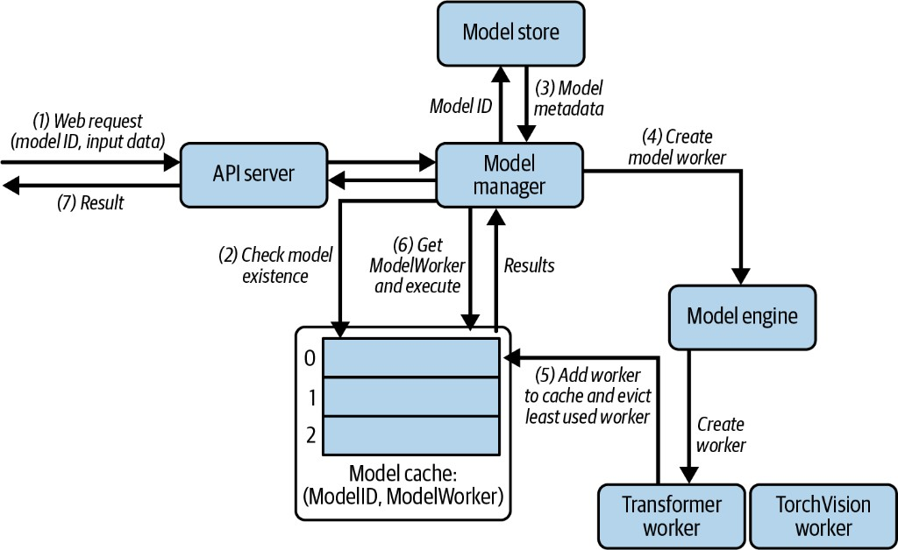
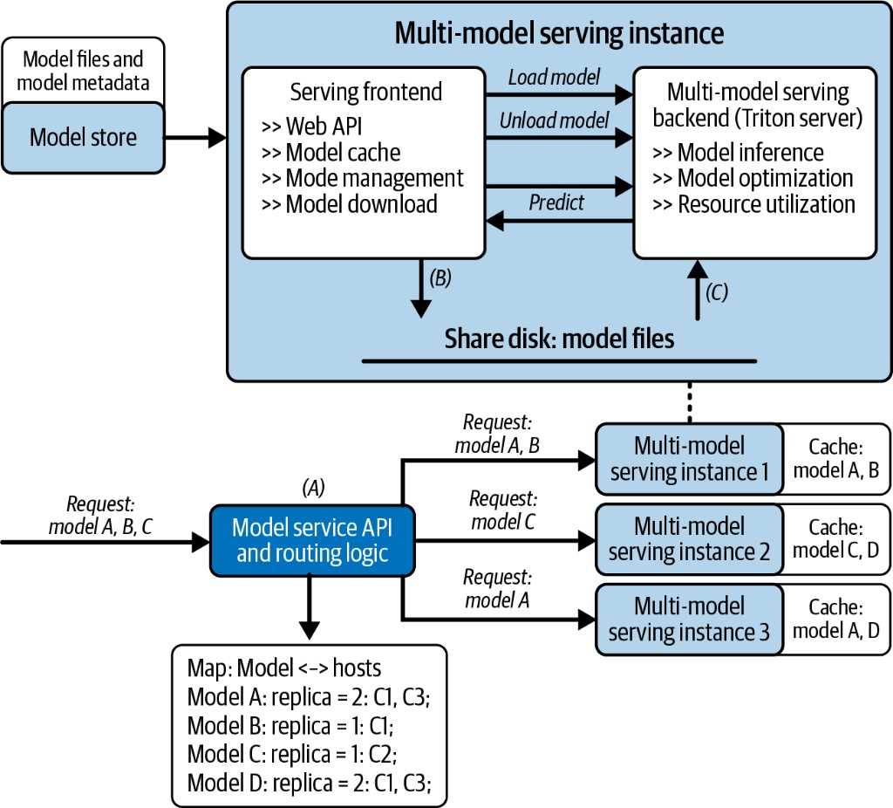
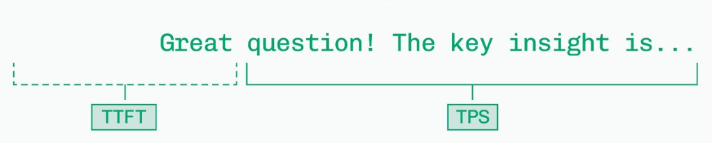

Production adds responsibilities beyond generating correct tokens: requests must complete reliably, latency must remain within targets, and resource costs must be attributable. Connect the request path to measurements before deciding how much capacity to provision.

## 13.1 The production inference stack

An engine benchmark cannot tell you whether users receive timely answers through the full application. Instrument arrival, queue admission, prefill, first delivered token, subsequent tokens, completion, and cancellation. A correlation ID connects those events without logging private prompts by default.

### Production responsibilities beyond the engine

A production service needs more than a model endpoint. Logging and tracing establish which model version handled a request and where time was spent. Metrics and alerts expose latency tails, failures, queue pressure, and resource saturation. Controlled rollouts compare versions under bounded traffic exposure, while capacity planning and cost attribution connect resource use to the teams or features consuming it.

Keep request identifiers, model/configuration versions, token counts, timings, and error state available without indiscriminately logging private prompt content. The purpose of an observability field is to resolve a concrete operational question.

### Architecture

The companion [multi-model teaching server](https://github.com/rangarajp/rangarajp.github.io/tree/main/notebooks/llm-inference/multi_model_serving) provides the custom endpoints below. Code labeled with an app filename is an excerpt from that project, not a standalone script. Recorded timings illustrate the original run only; GPU and version differences affect reproduction.

The demonstration limits resident model count; it does not implement a complete GPU-byte admission budget. Production must reserve memory before a cold load and protect in-flight workers from eviction.

A single-model server is simple: load weights once, answer every request with that model. Real platforms often need *several* models behind one API — different sizes, chat templates, or tasks — without keeping every checkpoint resident on GPU.

This chapter walks a small multi-model stack: one HTTP process, a model store, an LRU cache (capacity 2), and workers for two local chat models.

| Model ID | Checkpoint |
| -------- | ---------- |
| `qwen2.5-0.5b` | `Qwen2.5-0.5B-Instruct` |
| `tinyllama-1.1b` | `TinyLlama-1.1B-Chat-v1.0` |

<figure>



<figcaption><span class="figure-label">Figure 1.</span> Multi-model serving architecture</figcaption>
</figure>

| Box in the diagram | Code | Job |
| ------------------ | ---- | --- |
| API server | `app/server.py` | HTTP: `/models`, `/generate`, `/predict` |
| Model manager | `app/manager.py` | Cache lookup, LRU eviction, orchestrate load |
| Model store | `app/store.py` + `config/models.json` | Metadata + path resolution |
| Model cache | `OrderedDict` in manager | Resident `(model_id → worker)`, capacity `max_models` |
| Model engine | `app/engine.py` | Factory: create / delete workers |
| Model workers | `app/worker.py` | Load weights, run `generate` |

Request path (numbers match the figure):

1. Client sends `{model_id, prompt}` to the API server  
2. Manager checks the *model cache*  
3. On miss → load *metadata* from the store  
4. Engine *creates* the right worker  
5. Worker is *added* to the cache; if full, *evict* least-recently used  
6. Manager *executes* on the worker  
7. Result returns through the API  

```text
Client → FastAPI → ModelManager → (cache hit?)
                              ├─ hit  → worker.predict()
                              └─ miss → Store → Engine → LLMCausalWorker → cache → predict()
```

### Register models (store)

`config/models.json` lists what the platform *knows about*. Paths are *folder names* under `MODELS_DIR` — not absolute machine paths.

```json
{
  "models": [
    {
      "id": "qwen2.5-0.5b",
      "name": "Qwen2.5-0.5B-Instruct",
      "path": "Qwen2.5-0.5B-Instruct",
      "type": "llm",
      "framework": "transformers",
      "version": "1.0.0",
      "description": "Qwen2.5 0.5B Instruct — local causal LM"
    },
    {
      "id": "tinyllama-1.1b",
      "name": "TinyLlama-1.1B-Chat-v1.0",
      "path": "TinyLlama-1.1B-Chat-v1.0",
      "type": "llm",
      "framework": "transformers",
      "version": "1.0.0",
      "description": "TinyLlama 1.1B Chat — local causal LM"
    }
  ]
}
```

Machine-local roots live in a *gitignored* file (never published):

```text
local_paths.example.json   # committed template
local_paths.json           # your copy — gitignored
```

```python
from local_paths import load_local_paths, models_dir

cfg = load_local_paths()
MODELS_DIR = models_dir(cfg)
os.environ["MODELS_DIR"] = str(MODELS_DIR)
```

### LRU manager + engine

Default capacity is *2* — enough to keep both lab models warm. On a miss with a full cache, the oldest entry is unloaded.

```python
# app/manager.py (core of get_model_worker)
if model_id in self.model_cache:
    self.model_cache.move_to_end(model_id)
    return self.model_engine.get_worker(model_id)

if len(self.model_cache) >= self.max_models:
    evicted_id, _ = self.model_cache.popitem(last=False)
    self.model_engine.delete_worker(evicted_id)

worker = self.model_engine.create_worker(model_metadata)
self.model_cache[model_id] = worker
return worker
```

The engine picks a worker type from metadata (here: transformers causal LM):

```python
# app/engine.py
if model_metadata.framework == "transformers" and model_metadata.type == "llm":
    self.workers[model_metadata.id] = LLMCausalWorker(model_metadata)
```

`LLMCausalWorker` loads from disk with `local_files_only=True`, applies the chat template when present, and returns only newly generated tokens.

### Serving the API

```python
import uvicorn
from app.server import app

uvicorn.run(app, host="127.0.0.1", port=8001)
```

Endpoints used below: `GET /models`, `POST /generate`, `POST /predict`, plus admin helpers for cache demos.

### What we measured

When we exercised different scenarios against the running server, these were the inputs and outputs.

#### List models (cache empty)

*Input*

```http
GET /models
```

*Output*

```text
200
available: ['qwen2.5-0.5b', 'tinyllama-1.1b']
models_dir: <MODELS_DIR>
  qwen2.5-0.5b: resolved=<MODELS_DIR>/Qwen2.5-0.5B-Instruct
  tinyllama-1.1b: resolved=<MODELS_DIR>/TinyLlama-1.1B-Chat-v1.0
loaded: {}
```

`available` comes from the store; `loaded` is the cache. Nothing is resident until the first generate.

#### Generate — Qwen

*Input*

```json
{
  "model_id": "qwen2.5-0.5b",
  "prompt": "What is the capital of the United States? Answer in one sentence.",
  "max_new_tokens": 48
}
```

*Output*

```json
{
  "model_id": "qwen2.5-0.5b",
  "model_name": "Qwen2.5-0.5B-Instruct",
  "prompt": "What is the capital of the United States? Answer in one sentence.",
  "generated_text": "The capital of the United States is Washington, D.C., which was established as the nation's first city in 1790 to serve as its seat of government and to be the official residence of the President of the United States."
}
```

#### Generate — TinyLlama

*Input*

```json
{
  "model_id": "tinyllama-1.1b",
  "prompt": "What is 2+2? Answer briefly.",
  "max_new_tokens": 32
}
```

*Output*

```json
{
  "model_id": "tinyllama-1.1b",
  "model_name": "TinyLlama-1.1B-Chat-v1.0",
  "prompt": "What is 2+2? Answer briefly.",
  "generated_text": "2 + 2 = 4 in simple terms."
}
```

After both models have been hit once (`max_models=2`):

*Output*

```text
loaded_models: {
  'tinyllama-1.1b': 'TinyLlama-1.1B-Chat-v1.0',
  'qwen2.5-0.5b': 'Qwen2.5-0.5B-Instruct'
}
```

#### Concurrent requests (both models warm)

Four `/generate` calls in parallel (`max_new_tokens=40`).

*Input*

| model_id | prompt |
| -------- | ------ |
| `qwen2.5-0.5b` | What is attention? One sentence. |
| `tinyllama-1.1b` | What is continuous batching? One sentence. |
| `qwen2.5-0.5b` | What is speculative decoding? One sentence. |
| `tinyllama-1.1b` | What is a transformer? One sentence. |

*Output*

| model_id | time | generated_text (truncated) |
| -------- | ---- | ------------------------- |
| `qwen2.5-0.5b` | 3.39s | Attention refers to the process of selectively focusing on relevant information… |
| `tinyllama-1.1b` | 3.64s | Continuous batching is a technique used in data processing that involves processing batches… |
| `qwen2.5-0.5b` | 3.77s | Speculative decoding involves the use of computational methods to decode information… |
| `tinyllama-1.1b` | 3.57s | A transformer is a device that can transform one type of energy… |

Every response echoed the requested `model_id` — routing stayed correct under concurrency.

#### Warm latency (same model)

Same prompt twice on an already-loaded Qwen worker.

*Input*

```json
{
  "model_id": "qwen2.5-0.5b",
  "prompt": "Explain KV cache in 2 sentences.",
  "max_new_tokens": 48
}
```

*Output*

```text
call 1: 1.477s  status=200
call 2: 1.446s  status=200

generated_text: "A Key-Value (KV) Cache is an application layer storage that stores data
in a non-volatile manner using hash or bitmaps as key-value pairs. It provides
fast access to data and can improve the performance of applications by reducing disk…"
```

Once the worker is cached, repeat calls are generation cost only — no reload spike between call 1 and 2.

#### Errors

*Input* — invalid model

```json
{ "model_id": "does-not-exist", "prompt": "hello", "max_new_tokens": 8 }
```

*Output*

```json
{ "detail": "Model does-not-exist not found" }
```

*Input* — empty prompt

```json
{ "model_id": "qwen2.5-0.5b", "prompt": "", "max_new_tokens": 8 }
```

*Output*

```text
500  — Empty prompt
```

#### Token length vs latency (warm Qwen)

*Input*

```json
{
  "model_id": "qwen2.5-0.5b",
  "prompt": "Explain continuous batching briefly.",
  "max_new_tokens": <8 | 32 | 64 | 128>
}
```

*Output*

| `max_new_tokens` | Latency | Approx. chars |
| ---------------- | ------- | ------------- |
| 8 | 0.28s | 59 |
| 32 | 0.95s | 197 |
| 64 | 1.90s | 361 |
| 128 | 3.79s | 765 |

Decode cost scales roughly with tokens generated — same idea as single-model serving, now behind a model router.

#### LRU eviction (`max_models=1`)

*Input*

```json
POST /admin/cache/config   { "max_models": 1 }
POST /admin/cache/clear
POST /generate             alternate qwen2.5-0.5b ↔ tinyllama-1.1b
```

*Output (expected)*

With capacity 1, `loaded_models` holds only the last requested model; the previous worker is unloaded (server logs show `LRU eviction`). Restore with `{ "max_models": 2 }` when done.

### What this demo teaches

- *Store ≠ cache.* Registration is cheap; loading weights is expensive.  
- *LRU is the memory valve.* Cap how many checkpoints stay on GPU.  
- *Engine + workers* keep frameworks pluggable (transformers LLM today; other worker types fit the same factory).  
- *Routing is part of the contract.* Every response echoes `model_id` so clients can verify the right model answered.

This sits next to [LLM Serving Engine Internals](./continuous-batching) (one model, deep stack) as the *multi-model control plane*: same HTTP surface, many checkpoints, deliberate load/unload.

### Scaling out: multi-model cluster architecture

The lab is *one instance* that can load Qwen or TinyLlama with an LRU cache. Production multi-model platforms add a second concern: *which host should answer for which model?*

<figure>



<figcaption><span class="figure-label">Figure 2.</span> Multi-model serving — instance internals and cluster routing</figcaption>
</figure>

#### Inside one multi-model instance (top of figure)

| Piece | Role |
| ----- | ---- |
| Model store | Model files + metadata (registry) |
| Serving frontend | Web API, *model cache*, management, download |
| Serving backend | Inference runtime (e.g. Triton / vLLM) — load, unload, predict |
| Shared disk | Staged weights the backend can map into memory |

Flow:

1. Frontend downloads / stages a checkpoint from the model store onto shared disk *(B)*  
2. Frontend tells the backend to *Load model* (or *Unload*)  
3. Backend reads files from shared disk *(C)* and runs *Predict*  
4. Results return through the frontend  

That matches the lab: store → manager/cache → engine/worker → generate — plus an explicit load/unload control plane.

#### Across the cluster (bottom of figure)

A *model service API + routing logic* sits in front of many instances. It keeps a *map: model ↔ hosts* (replicas):

| Model | Replicas (example) |
| ----- | ------------------ |
| A | hosts C1, C3 |
| B | host C1 |
| C | host C2 |
| D | hosts C1, C3 |

Incoming traffic for models A/B/C is routed to instances whose *cache already holds* that model (or that are allowed to load it):

- Instance 1 — cache A, B → serves A and B  
- Instance 2 — cache C, D → serves C  
- Instance 3 — cache A, D → serves A  

So routing is not only load balancing — it is *cache-aware placement*: send the request where the weights are warm when possible.

#### Lab vs production

| Concern | This lab (one process) | Cluster figure |
| ------- | ---------------------- | -------------- |
| How many models resident? | LRU `max_models` on one host | Per-instance cache + cluster map |
| Who picks the host? | N/A (single process) | Model service router |
| Load / unload | Manager + engine delete worker | Frontend → backend Load/Unload |
| Failure / scale | Restart the process | New instances + updated model↔host map |

### Make eviction safe under concurrency

An LRU dictionary alone does not make model eviction safe. Track active users of each worker, serialize loads for a model, and evict only idle workers. Weight unload, request cancellation, and asynchronous GPU completion must agree before memory is reused. Bound concurrent cold loads so they cannot each reserve the same apparent free memory.

Route by model revision and adapter as well as model name. Cache-aware routing can reduce cold starts, but must still respect queue depth and per-tenant limits. Report cold and warm latency separately.

## 13.2 Key metrics in depth

### Key metrics

| Metric | Definition | Diagnostic use |
|---|---|---|
| TTFT | Arrival to first delivered token | Queueing, prefill, delivery |
| ITL | Gaps between delivered tokens | Streaming stalls |
| TPOT | Mean post-first-token time per token | Request decode pace |
| Throughput | Defined token count / wall time | Aggregate capacity |
| Goodput | Work meeting a stated SLO / wall time | Useful capacity |
| KV occupancy | Allocated blocks / usable blocks | Admission pressure |

```python
# Synthetic delivery times in seconds since request arrival.
times = [0.12, 0.14, 0.17, 0.19]
gaps = [b-a for a,b in zip(times,times[1:])]
tpot = (times[-1]-times[0]) / (len(times)-1)
print('TTFT:', times[0], 'TPOT:', round(tpot, 4), 'max gap:', round(max(gaps), 4))
```

TPOT is undefined for a one-token answer; do not divide by zero or substitute TTFT. Report request percentiles and output lengths together. Pooling every token gap weights long answers more heavily than short ones, so state your aggregation method.

#### Goodput, compliance, and model utilization

Define goodput as SLO-qualified requests or tokens per unit time, and report the compliance fraction separately. TTFT and TPOT targets must be evaluated jointly on each request. If 95% meet each target independently, joint compliance would be 90.25%; real request timings are often correlated, so calculate the observed joint fraction instead of multiplying marginals.

Model FLOP utilization compares estimated useful model operations per second with a relevant device peak. It can help interpret compute-heavy prefill, but a low number during bandwidth-limited decode does not by itself mean the implementation is poor. Pair it with memory traffic, achieved bandwidth, kernel shapes, and launch overhead. Use dense operation rates and the actual arithmetic format consistently.

### Latency metrics — TTFT, ITL, and TPS

When a user sends a prompt, the answer does not appear all at once. Two clocks matter: how long until the first token, and how fast the rest streams.

<figure>



<figcaption><span class="figure-label">Figure 3.</span> TTFT is the wait before the first token; TPS is how fast the remaining tokens stream</figcaption>
</figure>

| Metric | Full name | What it measures |
|--------|-----------|------------------|
| TTFT | Time to first token | Delay from request arrival until the first output token |
| ITL | Inter-token latency | Time between consecutive tokens after the first |
| TPS | Tokens per second | Generation rate after the first token (roughly $1 / \text{ITL}$ when ITL is steady) |

- *TTFT* is dominated by *prefill*: processing the full prompt and building the KV cache before decode starts. Long prompts and heavy queues push TTFT up.
- *ITL* is the *decode* step time — one new token per forward (plus any scheduling delay). Users feel this as typing speed.
- *TPS* is the reciprocal view of ITL over a window: more tokens per second means lower average inter-token wait.

A good interactive experience usually needs both: low TTFT (the answer starts soon) and stable TPS / ITL (the answer keeps flowing). Optimizing only one often hurts the other under load.

#### Percentile latency — what p50 means

Raw averages hide tails. Serving systems report *percentiles* of latency (for TTFT, ITL, or end-to-end).

*p50* (the median): half of requests are faster, half are slower. In plain language: *1 in every 2 requests is slower than this number.*

| Percentile | Meaning |
|------------|---------|
| p50 | 1 in 2 is slower |
| p90 | 1 in 10 is slower |
| p99 | 1 in 100 is slower |

p50 is a useful “typical user” number. For SLOs, also watch p90 / p99 — that is where queueing, long prompts, and interference show up.

### Arithmetic intensity — attention as an example

GPUs have two speed limits: how fast they do math (*FLOPS*) and how fast they move data from HBM (*bandwidth*). Which one bites depends on *arithmetic intensity*:

$$
\text{Arithmetic intensity} = \frac{\text{FLOPs performed}}{\text{bytes moved}} \quad [\text{FLOPs/byte}]
$$

- High intensity → lots of math per byte loaded → often *compute-bound*
- Low intensity → little reuse of loaded bytes → often *memory-bandwidth-bound*

#### Llama 3 8B decode attention vs H100 ridge

Worked example: Llama 3 8B (GQA), FP16 (2 bytes per element), sequence length $n{=}100$, one layer, attention-over-cache only (no $W_Q / W_K / W_V$ or MLP weight traffic).

Matmul FLOPs use the usual $2mkn$ count (multiply + add). Softmax is $O(n)$ and negligible next to the matmuls, so we omit it.

*H100 SXM ridge* (machine balance) — dense BF16 Tensor peak, not the sparse datasheet number:

$$
\frac{989\ \text{TFLOPS}}{3.35\ \text{TB/s}} \approx 295\ \text{FLOPs/byte}
$$

Workloads below this line are memory-bandwidth-bound on that GPU; above it are compute-bound. See [GPU Architecture](./gpu-fundamentals).

| Spec | Value |
|------|------:|
| Query heads $n_q$ | 32 |
| KV heads $n_{kv}$ | 8 |
| Head dim $d$ | 128 |
| Hidden size | 4096 |

GQA: 32 queries attend; only 8 key/value heads are cached (each KV head shared by 4 queries).

| Tensor / op | Read (bytes) | Compute (FLOPs) | Write (bytes) |
|-------------|-------------:|----------------:|--------------:|
| $Q$ $(n_q \times d)$ | $32 \times 128 \times 2 = 8{,}192$ | — | — |
| $K$ $(n \times n_{kv} \times d)$ | $100 \times 8 \times 128 \times 2 = 204{,}800$ | — | — |
| $V$ $(n \times n_{kv} \times d)$ | $100 \times 8 \times 128 \times 2 = 204{,}800$ | — | — |
| $QK^\top$ (32 heads) | — | $32 \times 2 \times 128 \times 100 = 819{,}200$ | — |
| $\mathrm{scores}\,V$ (32 heads) | — | $32 \times 2 \times 100 \times 128 = 819{,}200$ | — |
| output $(1 \times 4096)$ | — | — | $4096 \times 2 = 8{,}192$ |
| Total | 417,792 | 1,638,400 | 8,192 |

$$
\begin{align*}
\text{Memory} &= 417{,}792 + 8{,}192 = 425{,}984\ \text{bytes} \\
\text{AI} &= \frac{1{,}638{,}400}{425{,}984} \approx 3.8\ \text{FLOPs/byte}
\end{align*}
$$

Large-$n$ asymptote (KV dominates): $\approx 4\,n_q\,d / (2\,n_{kv}\,d \cdot 2) = n_q / n_{kv} = 4$ FLOPs/byte.

| Workload | AI (FLOPs/byte) | vs H100 ridge (~295) | Regime on H100 |
|----------|----------------:|----------------------|----------------|
| Llama 3 8B GQA ($n{=}100$) | ~3.8 | ≪ ridge | Memory-bound |
| Llama 3 8B GQA (large $n$) | ~4 | ≪ ridge | Memory-bound |
| H100 SXM dense BF16 | ~295 | — | Ridge |

Decode attention alone sits far below the H100 line. A full decode step is even hungrier for bandwidth: every layer also rereads all attention and MLP weights — which is why HBM GB/s, quantization, and batching move TPS more than raw TFLOPS.

Contrast with *prefill*, where many tokens reuse the same loaded weights → intensity rises toward (or past) the ridge → more compute-bound. That is why TTFT and TPS respond to different hardware knobs.

### Goodput and a percentile calculation

```python
# Nearest-rank percentile, stated explicitly because tools interpolate differently.
import math
latency_ms = [90, 95, 100, 105, 110, 120, 130, 150, 400, 900]
for percentile in (50, 90, 99):
    rank = math.ceil(percentile / 100 * len(latency_ms)) - 1
    print(percentile, sorted(latency_ms)[rank])
```

Goodput counts requests or tokens meeting a stated latency and quality objective per wall-clock second. It can fall under overload even while raw throughput rises. TTFT measured at the client includes queueing; a separate prefill timer must not be mislabeled TTFT. See [observability](./observability-slos) for a synthetic token-delivery trace.

### Latency — TTFT, ITL, and E2E

Serving clocks compose as:

$$
\text{E2E} = \text{TTFT} + (c - 1) \cdot \overline{\text{ITL}}
$$

| Symbol | Meaning |
|--------|---------|
| Queue | Time waiting for a scheduler slot / batch |
| TTFT | Arrival to first delivered token, including queueing, preprocessing, prefill, and delivery |
| ITL | Inter-token latency — one decode step (plus schedule delay) |
| $c$ | Completion tokens |

Related views:

- *TPOT* here is $(\text{E2E}-\text{TTFT})/(c-1)$ for $c>1$, the mean gap after the first token. E2E$/c$ is a different average that includes startup cost. For $c=1$, post-first-token TPOT is undefined.
- Per-request output TPS $\approx 1/\text{ITL}$ when ITL is steady.
- Report *percentiles* (p50 / p90 / p99), not only means — tails are where queueing and long prompts show up (the metric definitions above).

### Throughput and concurrency

| Metric | Definition |
|--------|------------|
| Output TPS (one sequence) | $\approx 1 / \text{ITL}$ |
| System TPS | Sum of tokens emitted across all in-flight sequences per second |
| Goodput | Tokens that meet the latency SLO |

Little's law for serving:

$$
\text{concurrency} \approx \text{arrival rate} \times \text{E2E latency}
$$

Raising concurrency raises system TPS until you hit a knee — KV memory, scheduler queueing, or the memory-bound decode roof described in hardware foundations. Past that knee, ITL and TTFT percentiles climb and *goodput* can fall even as raw TPS rises.

## 13.3 Failure modes and debugging

### Failure modes and debugging

High TTFT with low prefill time suggests queueing or upstream work. Good TTFT with intermittent streaming stalls suggests scheduler interference, delivery buffering, or contention. Out-of-memory failures late in answers suggest insufficient growth reservations or memory accounting. Inspect traces before changing hardware.

Cancellation must release request state and stop unnecessary GPU work. Readiness should mean the model can accept work, not merely that an HTTP process exists. Retry policies need bounded attempts: restarting a streamed answer can duplicate output and multiply load.

### Benchmark and operate

Use realistic prompt/output distributions and arrival rates, plus a concurrency sweep. Warm the engine, separate cold-cache from warm-prefix results, and include failures and rejected requests. Record software, model revision, quantization, hardware, and scheduler settings. Pair performance changes with quality checks.

Production layers include authentication, quotas, bounded queues, routing, healthy model replicas, and telemetry. Containers or orchestration do not remove these requirements. Continue with [capacity and cost](./observability-slos).

## 13.4 Cost modeling

Plan capacity from a measured workload that satisfies latency and quality objectives. Maximum unconstrained tokens per second can overstate the amount of useful service you can sell or deliver.

### Cost modeling

```python
# Hypothetical all-in worker price and measured output goodput.
worker_cost_per_hour = 3.0
output_goodput_per_second = 100
cost_per_million = worker_cost_per_hour * 1e6 / (3600 * output_goodput_per_second)
print(round(cost_per_million, 2))  # 8.33 currency units per million output tokens
```

This denominator counts output tokens from requests meeting the SLO. Input work is included in worker time but not counted as output. State this convention when comparing services. Add CPU, networking, idle replicas, storage, and operational costs if they are not already included.

### Estimate replicas

```python
import math
peak_requests_per_second = 12
measured_requests_per_worker_second = 4  # at the required length mix and SLO
operating_fraction = 0.75
workers = math.ceil(peak_requests_per_second /
                    (measured_requests_per_worker_second * operating_fraction))
print(workers)  # 4; redundancy may require additional capacity
```

This simple model reserves headroom, but assumes workers scale independently. Shared bottlenecks and prefix locality can violate that assumption. Test burst arrivals and worker loss. Include model-loading time when sizing warm capacity and autoscaling lead time.

### Improve efficiency systematically

Measure queueing and cache occupancy first. Then test prompt reduction, prefix reuse, batching, quantization, and replica placement one change at a time. Recheck quality and tail latency after each change. Buying more hardware is useful when a validated bottleneck remains and its cost is justified.

### Cost and capacity planning

From SLOs back to hardware:

1. Pick target p99 TTFT / ITL and tokens per request $(p, c)$.
2. Estimate concurrency from arrival rate × E2E (Little's law).
3. Check KV and weight capacity; if not, add GPUs or shrink context / precision.
4. Check decode bandwidth floor and matrix arithmetic intensity — more GPUs help memory fit, but per-GPU ITL still obeys HBM.
5. Convert GPU-hours to \$/M output tokens at your utilization assumption; overprovision for p99, not for the mean.

Rough capacity sketch:

$$
\text{GPUs needed} \approx \frac{\text{required system TPS}}{\text{achievable TPS per GPU at SLO}}
$$

Multi-model sharing adds fragmentation and cache interference on top of the single-model math — budget headroom.

## Recorded notebook observations

These observations come from the saved notebook runs linked below. Their model, timing boundary, and hardware assumptions are part of the result.

### Related server experiment: observe the knee before choosing concurrency

The repository's [single-model performance summary](https://github.com/rangarajp/rangarajp.github.io/blob/main/notebooks/llm-inference/observability/experiments/1.1_single_model_performance.md) reports the following client-load sweep for its Qwen2.5-7B teaching-server setup. This is a separate recorded server report, not the 0.5B offline batch comparison.

| Concurrent clients | TTFT p50 (s) | TPOT p50 (s) | System output tok/s |
|---:|---:|---:|---:|
| 1 | 0.056 | 0.031 | 31 |
| 2 | 0.061 | 0.032 | 60 |
| 4 | 0.167 | 0.038 | 91 |
| 8 | 0.580 | 0.038 | 96 |

Increasing concurrency from four to eight added little throughput while median TTFT rose substantially. That suggests an operating knee for this workload, not a production capacity guarantee. The table does not provide p99, arrival-process details, or a quality-qualified goodput measurement, so those remain useful additions to the report.

## Hands-on extensions

Use these experiments to connect the mechanisms above to measurements. They are proposed exercises unless a recorded result is explicitly identified.

### Hands-on: build a small load-to-SLO report

Reuse the serving experiment with a fixed prompt/output distribution and a request ID in every trace. Publish latency percentiles, rejected/cancelled counts, and goodput at increasing arrival rates. Keep client delivery timestamps distinct from engine execution timers.

### Hands-on: expose cold starts and safe eviction

Alternate two checkpoints with one- and two-worker cache limits. Publish cold/warm latency, resident memory, and an eviction timeline. Add concurrent requests to prove that an in-use worker is protected and that two simultaneous misses do not trigger duplicate loads.

### Hands-on: show the throughput knee

Reuse the concurrency sweep at 1, 2, 4, and 8 clients. Publish system output tok/s and TTFT/TPOT percentiles on separate axes, plus request counts and output lengths. Mark the chosen SLO so readers see why highest throughput may not be the best operating point.

### Hands-on: turn measured goodput into a sensitivity table

Use the measured load knee to compare required workers under several arrival rates, output lengths, operating headroom levels, and explicit hourly prices. Publish assumptions and cost per million useful output tokens; do not present the V100 lab’s throughput as a production guarantee.
